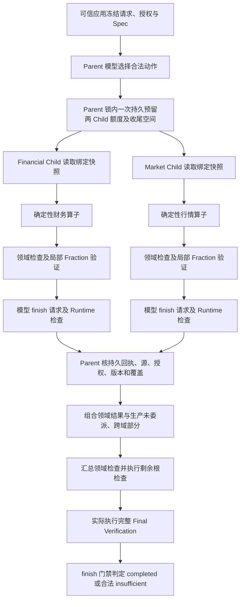

# Child Agent 机制梳理与面试题详解

整理日期：2026-10-10（Asia/Shanghai）。依据当前工作区源码、测试和 2026-10-09 最终验收报告；工作区包含既有未提交实现，因此这里描述的是当前文件状态，不是某个已发布版本。

本次仅整理文档和只读核对，不运行模型、金融 Provider 或新验收 campaign，不改变实现、默认、预算及历史评分。文中的测试通过数引用历史执行记录，不表示本次重新运行。

## 一、先准确描述当前系统

### 1. 可以在面试中使用的项目介绍

> 我们实现的是受限的 Agent-as-Tool 领域委派。Parent 通过注册工具调用 Financial 或 Market Child；父子使用同一个 DynamicRuntime 类和工具、证据、持久化基础设施，但每个 Child 都有独立的运行状态、消息、局部预算和运行 ID。子任务只能使用父请求已绑定的证券、时间窗口、PIT 和不可变快照，权限只能收窄。并行采用显式依赖图，启动前原子预留两个 Child 的最大额度并保留 Parent 收尾空间。最新实验版把领域计算和局部验证下放给 Child，Parent 验证真实执行凭据后消费结果，再实际执行完整最终验证。真实闭环已经完成，但当前小样本没有证明 Child 比强工具基线更省资源或产生更好的自主检查。

重点是“受控委派、可核查执行、全任务成本”，而不是 Agent 数量。

### 2. 不要混淆三条版本线

| 版本线 | 当前职责 | 必须保留的区别 |
| --- | --- | --- |
| 来源 Child：`financial-child-v1/v2/v3`、`market-child-v1/v2/v3` | 读取授权领域快照，保留缺口，申请结束 | v2/v3 改进进度与合法动作反馈；v3 没有获得领域计算权限。旧入口 Child 默认仍为 v1，v3 必须显式选择。 |
| 领域分析 Child：`financial-analysis-child-v1`、`market-analysis-child-v1` | 读取、选取冻结算子、确定性计算、领域检查、局部 Fraction 验证、结构化回传 | 独立实验身份；不是把旧 v3 原地扩大权限。对应 Parent 为 `dynamic-parent-domain-analysis-v1`。 |
| Parent 上下文：parallel v1–v6.2 | 进度反馈、无损表示、披露与有界工作集等逐步演进 | Parent 的 v6.2 不意味着 Child v6.2；分析 Child 有自己的协议和精确元数据编码，不能自动套用所有 Parent 分页能力。 |

真实验收报告中的 Parent 输入修订 v2/v3/v4，是冻结验收入口的控制说明修订，也不能直接当作业务 CLI 默认协议版本。

### 3. 职责和数据边界

| 角色 | 可以做什么 | 不具备的权力 |
| --- | --- | --- |
| 可信应用 | 冻结请求、身份、授权、源绑定、Spec 和预算 | 不以模型自报信息授予权限 |
| Parent 模型 | 在当前协议允许的动作中选下一步，输出短计划或请求 finish | 不生成金融事实、改公式、删必需检查、改 cutoff 或补快照 |
| Financial 分析 Child | 财务读取、`financial_snapshot`、`income_yoy`；明确金额 profile 才有 `profit_amount_change`；领域检查与局部验证 | 不读 Market，不改父目标，不再 spawn |
| Market 分析 Child | 行情读取、`market_price_window`、`factor_adjusted_window`；领域检查与局部验证 | 不读 Financial，不凭空补因子，不再 spawn |
| Runtime / Registry / Executor | 解析动作、查权限、执行业务工具、计账、判定进度、持久化与恢复 | 不把计划文字、哈希引用或模型的 verified 当执行证明 |
| Parent 验证与合并 | 认证 Child 真实回执，消费领域结果，计算未委派与跨域部分，执行原完整 verification | 不因局部 verified 就跳过最终验证 |

允许绑定的数据集包括 Financial 的 income/balance/cashflow 和 Market 的 daily/calendar/adjustment。具体运行只可访问原请求真正绑定且仍授权的子集。最新两个真实案例只覆盖既有 income/daily 源，不代表所有允许数据集已真实验收。

### 4. 最新分析 Child 的执行图



这是成功路径。任一必需分支 partial、取消、超时、权限失效或未知执行，都不能沿成功路径直接到 finish。合法 insufficient 则可以满足“检查确已执行”的依赖条件，并携带不足继续到根验证。

并行调度由 `ThreadPoolExecutor(max_workers=2)` 实现，属于同一进程内的两个独立 Runtime 实例。它不是跨机器调度，也没有新增一套 ParallelRuntime。

### 5. 单次模型循环

1. 检查取消、绝对 deadline、当前授权和已保存对象。
2. 根据实际状态生成 Observation、固定检查和合法动作，形成有界模型消息。
3. 检查完整 system/user 内容的 UTF-8 字节数和局部、根预算。
4. 先保存模型调用 intent、输入哈希和保守预留，再调用配置模型。
5. 校验模型身份、响应及用量回执，严格解析 JSON。
6. 在真正执行前再次核对权限、引用和依赖；先登记工具 intent、消耗工具尝试。
7. 工具生成确定性结果，Runtime 更新 revision、Observation、回执和 Checkpoint。
8. 非法动作、重复动作或过早 finish 消耗无进展次数；连续两次无进展停止。
9. finish 只是一项申请；Runtime 根据冻结检查和真实证据决定业务状态。

### 6. 当前分析模式预算

| 层级 | 决策上限 | 工具尝试上限 | 记账 Token 上限 | 时间上限 |
| --- | ---: | ---: | ---: | ---: |
| Root，含 Parent 和全部 Child | 16 | 18 | 96000 | 继承原绝对截止约束 |
| C 路线 Parent | 6 | 8 | 48000 | 240 秒 |
| 每个分析 Child | 5 | 4 | 18000 | 120 秒，且不得晚于 Parent |
| A/B 路线 Parent | 8 | 12 | 48000 | 240 秒 |

所有这些入口保持 12000 UTF-8 字节模型上下文上限和 `no_progress_limit=2`。旧来源 Child 的局部上限则为 3 决策、1 工具、18000 Token、120 秒。单次运行预算和验收 campaign 的多个运行总预算不是同一概念。

### 7. 当前证据能证明什么

最新主窗口与独立补验的最终覆盖：603207 正常同比和 688184 非正利润基数，两案例的 A 直接工具 / B 确定性领域工具 / C 分析 Child 均取得与完整 oracle 等价的最终结果。正常任务 completed，合法不足任务 insufficient。

原始评分必须同时保留：初始 4/6、主窗口复验 1/2、独立补验 1/1，共 9 次实际运行 6 次通过；最终六个案例路线格子全部有通过结果，不等于原窗口首次 6/6。

| 路线 | 此比较范围内总已知 Token，含失败与修正 | 完整测量 wall 合计 |
| --- | ---: | ---: |
| A：直接工具 | 24841 | 30.610 秒 |
| B：确定性领域工具 | 55656 | 62.171 秒 |
| C：分析 Child | 59068 | 68.063 秒 |

C 相对 B 多 6.13% Token，相对 A 多 137.78%，未达到预先冻结的至少节省 10% 的候选门槛。上述 wall 是完整测量口径，Runtime 内部 wall 是另一列，不相互替代。三个路线的控制说明修订、请求顺序和失败重试不同，不能归因于 Agent 数量这一个变量。

两个 C 运行各自：Parent 5 决策、两个 Child 各 4 决策，共 13；工具尝试共 11，包含两个 AgentTool 包装调用。每例 Child 领域计算 Tool 2 次、算子 4 项、局部 Fraction 2 次；Join 重复生产和局部 Fraction 均为 0；实际完整 Final 1 次，另外保留完整性审计 19 次。

这些结果证明职责下放、合并和完整验证可运行；实测路径仍为 read → calculation → review → finish，没有证明有意义的自主检查增量。当前继续显式实验，默认不变。

全领域分析工作跨历史批次的用量另有旧 unknown：已知 167555 Token，API 未知预留 22338，另有局部 Root 4095 预留。它们不包含在上表这一个比较范围内，不能把 139565 当作整个工作全部实际成本，也不能把未知预留当成真实已发生费用。

## 二、面试问题与详细参考答案

### 01｜你会如何定义项目里的 Child Agent？它与普通 Tool 有什么区别？

**参考答案：** 普通 Tool 执行一次固定业务契约，例如读取某个已绑定领域数据。Child Agent 通过 AgentTool 被 Parent 调用，但内部有自己的模型决策循环、Observation、运行状态、预算和完成门禁。它在局部任务范围内选择下一项合法动作，然后把完整结构化结果交给 Parent。

当前系统还提供确定性领域 Tool：把读取、计算、局部检查打包为固定操作，不需要 Child 的模型循环。这构成三层区别：单次能力、固定领域流程、模型驱动的领域循环。不能只凭函数名含 agent 就认定有自主能力。

**追问：什么时候应选哪一种？** 单次读取优先普通 Tool；固定步骤优先领域 Tool；有真实、可评估的反馈分支或检查选择需求时才考虑 Child。当前两个真实案例没有证明第三种比前两种有收益。

### 02｜“复用同一 Runtime”是否意味着父子共享同一份状态？

**参考答案：** 不是。父子使用同一个 `DynamicRuntime` 类与共同基础设施，每个 Child 则是新的实例，带独立 run_id、请求投影、消息、trace、局部计数和 deadline。共享的是受控数据服务、Checkpoint Store、模型适配器及一套执行规则，不是可随意写入的 Parent 状态。

并行 worker 不持有可变的 Parent 状态、根账本或父执行器。只有 Parent 协调者在父运行锁内更新根账本和导入结果。这样既复用安全语义，又避免两个 worker 竞争修改父状态。

**追问：为什么不单独写一个 MultiRuntime？** 新 Runtime 会重复实现授权、PIT、预算、恢复和证据核验，容易形成规则差异。当前多 Agent 是同一执行基础上的策略与编排扩展。

### 03｜早期 v3 Child 与当前分析 Child 到底差在哪里？

**参考答案：** 旧 `financial-child-v3` / `market-child-v3` 只读取领域源，不能调用 calculation 或领域 review。其改进是告诉模型“读取已完成、质量缺口仍保留、下一步可以合法 finish”，并提供精确动作键与格式反馈。

新分析 Child 使用独立的 `*-analysis-child-v1` 身份，真正运行确定性领域算子，再执行领域假设检查和独立局部数值验证，返回完整结果。Parent 消费它生产的领域内容，不再重复生产同一领域。

**追问：为什么不直接放开旧 v3 的工具白名单？** 权限、任务、结果、预算和恢复语义都会变化。原地修改会使历史付费消息和 Checkpoint 无法按原契约解释，必须独立版本化。

### 04｜模型的自主权究竟在哪里？哪些事情必须由程序决定？

**参考答案：** 模型决定合法动作的选择、允许范围内的执行顺序、短计划和结束申请。新 Child 可以把尚未执行的冻结算子合并执行，也可以按允许方式分开执行。

程序决定授权、源绑定、算子实现、必需检查、数值、证据关系、支持状态、预算、依赖与最终完成状态。所有冻结必需算子都要完成，模型不能把不利检查从计划中删除。

因此当前自主权是受限的顺序与动作选择。`legal_next_actions` 常常把下一步收窄为一项，这有助于可靠性，也限制了可展示的自主增量。

**追问：有四轮模型调用就能证明 Agent 有价值吗？** 不能；如果真实轨迹始终等价于一个固定流程，调用次数只证明付出了协调成本。

### 05｜当前使用原生 Function Calling 吗？如何约束模型输出？

**参考答案：** 当前使用应用层严格 JSON 文本动作，没有接入原生 `tool_calls`。解析器校验动作种类、精确字段集合、工具白名单、引用、版本和依赖，拒绝额外字段、非法数字结构、重复 JSON key 和不合法引用。

例如分析 Child 的计算动作可以是：

```json
{"action":"tool","tool":"calculation","refs":["financial","operator:financial_snapshot","operator:income_yoy"],"plan":["执行剩余财务算子"]}
```

结束动作必须是另一种形状：

```json
{"action":"finish","reason":"completed","plan":["提交领域结果和保留缺口"]}
```

这两个对象是契约示例，不是本次真实模型输出。finish 不允许混入 tool/refs；解析通过也不代表通过执行权限和完成门禁。Runtime 不会偷偷改写非法输出来冒充模型成功。

### 06｜为什么需要 `legal_next_actions`？它与 `plan` 有什么区别？

**参考答案：** `plan` 是模型的控制文字，可能已经过期；`legal_next_actions` 则由当前已执行状态、算子集合、结果 revision 和授权能力确定性生成。它告诉模型下一步有哪些有效选择，但本身不执行工具。

最新真实 B 路线曾在不支持的模式下选择 parallel；后续又重复选择已完成 Market Tool。验收入口的说明修订强调当前合法动作比历史 plan 更有约束力，保留原两次无进展规则后才完成补验。

**追问：直接信任这个列表可以省掉执行校验吗？** 不能。模型可能忽略列表，付费调用期间权限也可能变化；解析、Runtime 和数据层仍要校验。

### 07｜如何避免 Child 权限超过 Parent？

**参考答案：** 有效权限由可信应用授予、父 Spec、父当前有效工具、委派范围、Child Spec 和服务策略共同收窄；具体请求再投影到该领域已绑定的数据集与 Provider。数据权限与工具权限是两条都要满足的边界。

以 Financial 为例，父可用财务和行情不意味着 Child 能读行情；父绑定了财报快照也不意味着 Child 能刷新或换快照。旧来源 Child 只有 financial；分析 Child 只有 financial、calculation、domain_review，均没有 AgentTool。

**追问：模型输出一个授权 ref 呢？** ref 只能标识对象，不能创造权限。授权来自可信运行上下文和服务层，每次实际读、复用和恢复重新检查。

### 08｜为什么缓存命中和恢复也要重新授权？

**参考答案：** 原来允许读取，不代表现在仍允许披露。Parent 可能已经撤销委派，SourceGrant 可能失效，源附件或快照完整性也可能异常。如果缓存绕过授权，就会继续泄露已被撤权的数据。

`ToolExecutor` 的复用键包含 tool/version、完整请求、scope、Provider 范围和 wave。命中前仍会重新读取本地不可变数据、核权限并比较结果，只复用聚合语义；这不是跨用户共享的 Provider 网络缓存。

**追问：重新读取是否等于重新采集？** 不等于。这里读取原绑定快照并重核权限，不调用 Provider refresh，不改变 cutoff 和快照。

### 09｜PIT 与不可变快照解决了什么问题？

**参考答案：** 不可变快照固定“这次研究用了哪个源版本”；PIT 约束“在研究 cutoff 当时，这条记录能否合法可见”。二者互补，快照存在并不自动证明历史时点可见。

所有 cutoff 必须带时区。基本条件是 `available_at <= cutoff`；system 模式另外要求 `ingested_at <= cutoff`。报告期只是指标所属期间，不等于披露时间；今天抓到的修订值不能因为旧公告日期就冒充历史可见版本。

Child 必须继承这些约束。遇到缺口只能保留不足，不能换成今天的快照或推迟 cutoff 来让结果通过。

### 10｜为什么当前只允许两类 Child，且深度为 1？

**参考答案：** 当前工程契约只覆盖 Financial 和 Market，每域至多一个 Child。限制来自多层：Spec 工具白名单、请求投影、动作解析、父委派计数和并行组检查。Child 不含 AgentTool，且需要绑定 Parent 与继承 deadline，不能自由成为新的根运行。

限制深度使权限、预算、恢复身份和证据所有权保持可检查。递归委派不仅是再调用一个函数，还会涉及嵌套根额度、取消树、重复任务和回传验证；当前没有实现这些范围。

**追问：这是不是普遍最优架构？** 不是普遍结论，是当前明确实施与验收范围，不能把未实现的分布式或递归能力写进项目经历。

### 11｜并行机制的关键为什么不是线程池，而是 DAG？

**参考答案：** 线程池只提供同时执行的手段，DAG 决定哪些步骤可以同时执行、哪些必须等待。两个领域分支可以独立推进，各自完成读取、计算和 review；Parent 的组合必须等待两个有效 Join，之后才是剩余假设检查、最终 verification 和 finish。

系统保存组 ID、Child ID、依赖、预留、状态、开始结束时间、结果引用和是否导入。恢复时核对这些字段与历史事件，禁止重复启动或在前置条件未满足时执行依赖步骤。

**追问：一个分支成功、另一个失败怎么办？** 保存成功回执与失败事实，但必需分支不齐时 Parent 不能宣布完成。一个分支是合法 insufficient 则是另一回事：其工作确已做完，可以带不足继续。

### 12｜为什么两个 Child 必须一次性原子预留预算？

**参考答案：** 如果两个 worker 分别读取根剩余额度再扣款，都可能看到同一余额而超分配；先启动一支后才发现另一支不够，也会破坏冻结的并行任务契约。

当前在父运行锁内先计算两份最大局部额度和 Parent 剩余空间，再构造一次 `children_reserved` 事件，并把账本与并行组意图一起持久化，之后才提交 worker。任一维度不满足，两个分支都不启动。

约束逐维成立：

```text
已记账或保留的占用 + 两 Child 最大预留 + Parent 剩余局部空间 <= Root 上限
```

**追问：账本函数本身能防止所有并发覆盖吗？** 不能。它返回校验后的新账本，不提供跨机器 compare-and-swap；正确性依赖调用方持有父运行锁并先持久化。

### 13｜为什么还必须保留 Parent headroom？

**参考答案：** Child 全部成功后，Parent 仍要组合、处理剩余检查、执行最终验证和 finish。如果把所有额度分给 Child，可能得到两个好结果却没有完成根任务的资源。

当前 `_parent_headroom` 保留 Parent 整个剩余局部 envelope，并检查待执行 calculation/hypotheses/verification 所需步骤，以及至少一次 finish 决策。finish 不消耗工具尝试，但会消耗模型决策和 Token。

例如分析 C 的静态决策包络为 Parent 6 加两个 Child 各 5，正好是 Root 16。已经花掉的父决策和尚未结算的预留仍在根账本中，不会因进入 Child 而清零。

### 14｜reserved、accounted、actual Token 有什么区别？

**参考答案：** reserved 是派发前的保守预留；accounted 是预算约束采用的已知用量加仍须保留的未知占用；actual/known Token 来自合法模型回执。

Runtime 使用输入 UTF-8 字节数加固定开销与输出额度进行保守预留，这不是模型实际 tokenizer 的计费结果。回执已知后，用可核验实际量结算；结果未知时保留原预留，不能写零。

根账本还预留 Child 整个局部额度，再在获得可信完整使用回执后释放可证明未使用的部分。因此累计预留不能当实际消费；只看 Parent Token 也会漏掉 Child 成本。

**追问：11 个工具尝试怎么算？** 真实 C 例中 Parent 为两个 AgentTool 包装加 composition/hypotheses/verification 共 5 次，两个 Child 各 read/calculation/review 共 3 次，合计 11。

### 15｜模型调用超时了，为什么不能默认重试？

**参考答案：** 本地没收到响应，不代表服务端没执行或没计费。如果自动重发，可能重复消费，并且无法把两次外部结果可靠映射到同一冻结动作。

当前先保存 paid intent、消息哈希与预留，再发 HTTP。若崩溃或连接异常导致结果未知，恢复看到 unresolved intent 就保留未知状态和额度，不自动重发。缺少整个 Child 的可信回执时，可能需要保留整份分配；有完整局部回执时也不能释放其中未知模型调用的 Token。

**追问：pending 与 unknown 相同吗？** 不同。在途 pending 是正常并行状态；terminal unknown 表示已停止且结果无法确认。真实验收曾把前者误认作后者，在 Market HTTP 前错误停止，修复后保留了原失败和预留。

### 16｜取消与超时如何传播？能否强行终止网络请求？

**参考答案：** Child 的 deadline 是父绝对截止与本地时限的较早者。并行组还使用共享取消事件，Child 同时检查组取消和根取消。分析 Child 发生未知付费结果时会通知并行停止新增派发。

这是协作式取消：已经进入同步网络调用的线程不保证立即终止，必须依赖有界 I/O 超时完成退出。代码会等待 worker 收束；不能承诺取消按钮立刻停止服务端执行或计费。

迟到或取消后的结果保留执行、费用和失败证据，但不能导入 Parent 研究状态。是否产生费用与是否可以接受业务结果是两个判断。

### 17｜为什么 Child 返回一个 `verified=true` 不足以被信任？

**参考答案：** 普通字段甚至整份内容哈希都可以由报告提供者一起伪造。Validated Join 必须读取实际 Child Checkpoint 历史，核对 run/parent/task/request/Spec、原 deadline、source revision、读取/计算/review 的真实开始结束事件、付费动作历史和用量。

然后核对完整输出清单：Fact、Evidence、假设、缺口、反证及所有权；从历史重建局部验证凭据，并与报告和持久状态一致。只有 Runtime 认证后的结果才能进入可信消费路径。

**追问：content hash 和 execution receipt 的区别？** hash 证明内容绑定与一致性；receipt 必须与受信任的真实执行历史连接，才能证明指定步骤实际发生。两者都不能单独取代授权。

### 18｜Child、Join、Parent 最终验证各自负责什么？

**参考答案：** Child 的 `domain_review` 执行领域规则和独立 Fraction 局部验证。Join 验证身份、授权、PIT、不可变源、revision、实际回执、ownership 与 coverage，正常可信路径不再做局部 Fraction 或重复领域生产。Parent 组合结果、处理剩余或跨域检查，再由模型实际选择并执行完整根 verification。

还要区分 Runtime 为防篡改和恢复进行的完整性审计。它可以调用完整 verifier，但不能代替模型确实执行了所要求的最终验证动作。

真实 C 每例局部 Fraction 2 次、Join 局部 Fraction 0、实际完整 Final 1，另外完整性审计 19。不能把“Join 不重算”说成“系统全程只验证一次”。

### 19｜Join 不重算如何防止伪造？`ValidatedDomainResult` 是什么？

**参考答案：** 持久化中的执行凭据先由 Runtime 从真实 Checkpoint 链重建。认证后，程序生成进程内不可变 `ValidatedDomainResult`，绑定请求、源、结果、局部验证与覆盖清单；其私有签发入口和进程内 HMAC 防止普通字典被当作可信结果。

这个对象不保存为可直接复用的 Checkpoint 信任标记，也不发送给模型。进程重启后必须重新认证持久执行，再生成新的可信对象。直接传普通字典走旧公共组合入口，仍须进行独立领域验证，不能借此跳过核验。

**追问：这能防御任意恶意 Python 代码或数据库管理员吗？** 不能这样承诺。可信应用代码和持久化访问边界仍是前提；进程内 capability 与普通哈希链不是远程硬件证明或外部不可篡改公证。

### 20｜Parent 怎样做到不重复生产 Child 已完成的领域结果？

**参考答案：** `compose_domains` 对已认证的委派领域直接消费其完整结果，只为未委派领域运行生产算子，再生成跨域部分。`test_remaining_hypotheses` 接收已有领域检查，仅执行 Parent 所有或未委派的检查。

明确的 ownership 规定每个 Claim 类别与假设归哪个领域；合并时核对 ID、名称、输入 Evidence、缺口和反证，冲突拒绝，不能“最后一个覆盖前一个”。即使最终没有跨域数字，Parent 仍需完成冻结的组合及验证流程。

**追问：怎么证明真的没重复？** 除结果等价，还要查看真实 `produced_domains`、算子调用数、Join 的 production/Fraction 计数及阶段 Trace。两个真实 C 例中 Parent 的 `produced_domains=[]`。

### 21｜为什么 revision 要绑定源和领域结果，而不是只有一个 done 布尔值？

**参考答案：** done 只说明“某时做过”，不能证明“对当前输入做过”。如果加入另一个已授权源或新接收一个领域结果，旧 calculation、hypotheses、verification 的结论可能已经过期。

新分析 Parent 的当前 revision 是对 sources 和每个 domain result digest 的绑定；计算、假设与验证分别记录对应 revision。只有当前输入与各阶段 revision 一致，且实际执行回执成立，该阶段才能通过完成门禁。

这也影响去重：同输入同动作是重复，不应再派发；新合法输入版本则不能仅凭工具名相同就误判为已经完成。当前项目不会用 refresh 或改 cutoff 制造新输入版本。

### 22｜completed、insufficient、partial 应如何区分？

**参考答案：** completed 表示所需执行完成且证据足以支持规定输出；合法 insufficient 表示规定检查已经实际执行，但数据或规则前提不足；partial 表示执行因预算、无进展、失败、取消等未完整完成。

以 688184 为例，非正利润基数不满足规定同比百分比前提，不能强算一个百分比或偷偷改成金额变化。完成全部原必需步骤后，最终仍应 insufficient。一次回执中模型请求 completed，Runtime 根据已验证不足如实给 insufficient。

**追问：内部 `phase=completed` 是否代表业务成功？** 不一定，它也用于表示运行状态机已终止并生成报告；业务结论必须看 report.status、stop_reason 和 required_checks。

### 23｜如何防止提前 finish 或重复动作形成死循环？

**参考答案：** 必需检查在开始前冻结。模型申请 finish 时，只要仍有 `not_completed`，Runtime 返回 `required_checks_pending` 及未完成检查 ID；completed 和 insufficient 两种 finish 都不能绕过执行。

同一输入下的重复动作不会再次派发业务工具，并记为无进展。非法动作、重复动作和过早结束都占用模型轮数及已发生 Token；连续两次无进展触发停止，不能用重写 plan 清零。

历史 600500 的 Financial 来源 Child 读完后重复读取，导致原并行验收 0/1；v2 修复仍失败，v3 同案例闭环通过。真正修复的是可信进度和精确动作反馈，不是自动完成重复动作或放宽 finish。

### 24｜12000 字节上下文上限如何执行？为什么不用 LLM 摘要？

**参考答案：** 上限针对模型 system/user 内容的 UTF-8 字节，不是 12000 Token，也不是整个 HTTP 包大小。每次派发前测量，必需合法视图仍超限则类型化停止，不截断事实或提高 cap。

当前分析协议采用精确表、symbols、list_table 和列布局减少重复 metadata；数值保持字面值，支持确定性回解。已有 Parent 上下文版本还包含目录、按阶段披露和有界分页，但要按所选协议区分，不能假定分析 Child 自动拥有分页动作。

LLM 摘要可能丢失反证、输入、顺序、缺口或边界条件，会改变验证语义。当前采取可逆表示，并保留程序侧完整对象。

**追问：字节少 10% 是否等于 Token 省 10%？** 不等于，必须用实际模型回执比较；还要计入额外轮数、Child 和失败成本。

### 25｜数据披露、读取、验证之间为什么必须分开？

**参考答案：** 引用或目录告诉模型对象在哪里；披露让模型看到内容；业务读取和 verification 则是 Runtime 执行并留回执的动作。三者的语义不相同。

模型看到了 verification 的说明或某个 verified 元数据，不代表它已经选择并成功执行最终验证。相反，完整 verifier 可以在程序侧检查全部对象，不必为了检查本身把所有 Evidence 全文塞入当前模型窗口。

父上下文重构通过真实执行凭据保持这个区别。页 ref、cursor、hash 也不是权限票据；必须绑定原窗口和对象版本并重新授权。

### 26｜Checkpoint、Trace 和 Root Budget 分别是什么？

**参考答案：** Checkpoint 保存可恢复状态；Trace 记录模型、工具、预留、导入和验证等事件；Root Budget 记录与重建父子资源占用。三者互相核对，防止出现“报告说执行了，但预算和事件没有记录”的情况。

本地 Checkpoint Store 使用 SQLite，按 `(scope, run, seq)` 追加状态；每条记录带 previous/hash 形成完整性链，并用 OS 文件锁限制同一运行并发写。append 使用数据库事务。

恢复除了校验哈希链，还核原 request、Spec、requirements、deadline、Trace 前缀、paid wire 和当前授权。普通哈希链能发现不一致，但不等于有外部锚定的绝对不可篡改账本。

### 27｜给你三个崩溃点，你会如何恢复？

**参考答案：**

1. **两 Child 额度已预留，worker 尚未启动。** 从已保存组与 Child ID 恢复，沿用原分配和 deadline；不能创建第二组或再预留。
2. **Child 已完成并持久化，Parent 尚未 Join。** 读取实际 Child 结果，核权限、原任务、用量与真实回执，只补必要结算和导入；不再调用 Child 模型。
3. **paid intent 已保存，模型回执未保存。** 将结果保持未知，保留额度并受控停止，不自动重发。

若 Parent 已导入一部分，则依据 submitted 标记、tool_call_id、result_ref 和账本事件恢复，不重复导入或结算。已完成运行的只读回放应得到相同报告，零新增模型调用、Provider 网络调用与 Checkpoint 追加；内部仍可能重新读取源并执行完整性核验。

**追问：能否声称全局 exactly-once？** 不应。工程提供的是有边界的意图持久化、已知结果幂等恢复和未知结果不重放，不具备外部模型服务的全局事务。

### 28｜如何测试 Child 机制，避免只测 happy path？

**参考答案：** 应分开验证机制、安全和真实行为。

- 契约：旧版本身份、严格 JSON、跨域/递归拒绝、固定目标与 required checks。
- 预算与并发：两分支一次预留，任一维度不足则 worker 零启动，Parent headroom 保留，完成顺序不改账本。
- 真实性与授权：缓存撤权、伪造 report、协调修改 hash、缺失 review 回执、PIT/快照/ownership 变化均拒绝。
- 恢复：在预留、paid intent、Child 完成、Join 和导入之间注入崩溃，核重复模型派发、预留与导入均为零。
- 业务等价：A/B/C 的完整 Fact/Evidence/缺口/反证/假设与独立 oracle 一致；合法不足保持。
- 真实模型：必须查看真实 paid action、完整 final、并发 I/O 和用量，不能拿合成动作证明模型真的自主选择。

历史最终记录为完整 1159 项中 1143 通过、16 数据库项跳过，16 项另在隔离 PostgreSQL 全部通过。本次只是核对记录与测试代码，没有重新执行该门禁；也不能据机制测试宣称 Provider 金融真值已认证。

### 29｜如何公平评估 Multi-Agent 是否有收益？项目实际结论是什么？

**参考答案：** 至少保留同目标的 A 直接 Tool、B 确定性领域 Tool、C 分析 Child 三条路线。固定真实输入、完整 oracle、授权、完成标准和根预算；先满足质量，再比较整个 Parent 加全部 Child 的资源，纳入失败和复验。

预先明确主指标，不能看到 Token 不占优就改报 Parent Token 或某次最快 wall。需要记录结果版本、Prompt 修订、请求顺序、缓存、未知费用和未覆盖场景。

本项目最终两案例六格覆盖完整，但总九运行只六次通过。当前比较范围内 C 为 59068 Token，B 为 55656，A 为 24841；C 对两强基线均未达到节省 10% 的门槛，wall 也未显示加速。真实 Child 的轨迹没有显示有意义的检查选择，因此功能完成与自主价值、效率收益必须分开结论。

**追问：能否据此断言 Multi-Agent 永远更差？** 不能；这只是两个非盲案例与当前预算/任务结构下的证据。也不能反向把未来可能性写成当前已验证优势。

### 30｜如果让你提出下一步设计，你会优先改什么？

**参考答案：** 先用现有 Trace 判断成本来自哪里，并让任务结构决定实现：对固定步骤保留强领域 Tool；只有真实存在缺口驱动的检查分支、且这些选择可能改善完整输出时，才值得提出新的 Child 实验。

可提出但尚未据此实施的方向包括：更清楚地区分合法动作和历史计划；按实际瓶颈减少重复元数据或重复核验；为确有条件分支的任务设计同题强基线；分列局部计算、Join、完整验证和模型时间。所有改变都应独立版本化，并保持原事实、权限、PIT、未知结果策略和最终完整 verifier。

不能为了证明 Child 有用而削弱 A/B、删除失败、扩大旧预算、跳过验证、放开任意公式或悄悄增加领域。若无收益证据，保留实验入口或使用普通 Tool 就是合理工程结论。本题是设计讨论，不授权自动实施新阶段。

## 三、面试组织和评分建议

### 1. 一场 60 分钟面试

| 时间 | 内容 | 推荐题目 |
| --- | --- | --- |
| 0–8 分钟 | 项目介绍和边界 | 01、02、03、04 |
| 8–20 分钟 | 执行协议和安全 | 05、07、09、22 |
| 20–35 分钟 | 并行、预算与故障 | 11、12、13、15、16 |
| 35–48 分钟 | 结果信任与恢复 | 17、18、19、27 |
| 48–60 分钟 | 测试、收益与判断 | 28、29、30 |

时间有限时，不要求逐题背诵。重点让候选人沿一次实际 Child 调用解释“谁提供授权、谁持久化、谁计账、谁判完成、失败后怎么办”。

### 2. 评分维度

| 维度 | 分值 | 高分表现 |
| --- | ---: | --- |
| 架构与版本理解 | 20 | 区分同一 Runtime 类与独立实例，区分来源 Child 与分析 Child，说明模型自主边界 |
| 数据与授权安全 | 20 | 权限交集、每次重授权、不可变快照、带时区 PIT、证据血缘均讲清楚 |
| 并行和预算 | 20 | 解释原子预留、父收尾空间、未知预留、协作取消与迟到丢弃 |
| 验证和恢复 | 25 | 区分内容哈希和真实回执、局部/Join/Final、revision、崩溃窗口及幂等导入 |
| 实验判断 | 15 | 使用完整成本和强基线，保留失败分母，坦诚收益未证明 |

典型低分回答：把模型 finish 当成功；把 verified 字段当凭据；说 Child 可自由改 scope；超时自动重发；只算 Parent Token；把六格最终覆盖说成首次全部通过；把合成测试当金融真值；把 v3 来源 Child 说成已经会计算。

### 3. 五个可口述的故障场景

| 场景 | 应有结论 |
| --- | --- |
| Child 读完后因 coverage_not_verified 再读相同源 | 读取执行完成与数据质量缺口分开；重复不派发，保留缺口，按契约结束或继续必需分析 |
| 两个 worker 都看到剩余 5 次决策，各自想预留 3 次 | 一次原子校验整体 6 次，加父空间后拒绝，不能先启动任何一支 |
| Child 已局部 verified，Parent 直接 finish | 拒绝；Parent 组合、剩余检查与实际完整 verification 仍须完成 |
| 模型请求外发后进程崩溃，回执未保存 | unresolved paid intent，未知用量保留，不自动重发 |
| 两个 Child 都成功，但总 Token 更高、路径固定 | 工程功能通过；自主价值与效率收益不通过，保持实验或选择强 Tool 基线 |

## 四、源码与证据索引

下表是当前工作区入口，优先看实现和对应测试，再阅读历史记录。历史文档含当时“进行中”状态，应以当前最终报告与日期为准。

| 内容 | 代码或文档 | 核心入口 |
| --- | --- | --- |
| 动态循环与子实例 | [dynamic.py](../src/stock_research/research/dynamic.py) | `DynamicRuntime`、`_child_context`、`_parent_headroom`、`_current`、`_check_results`、`run` |
| 旧来源 Child 契约 | [dynamic_contracts.py](../src/stock_research/research/dynamic_contracts.py) | `FinancialChildSpec`、`MarketChildSpec`、`ParallelParentSpec` |
| 旧 v3 进度反馈 | [dynamic_protocol.py](../src/stock_research/research/dynamic_protocol.py) | `_child_progress`、`_exact_child_system` |
| 新分析身份与任务 | [domain_analysis_contracts.py](../src/stock_research/research/domain_analysis_contracts.py) | `FinancialAnalysisChildSpec`、`MarketAnalysisChildSpec`、`DomainAnalysisParentSpec`、`domain_task`、`ownership` |
| 新分析动作与精确视图 | [domain_analysis_protocol.py](../src/stock_research/research/domain_analysis_protocol.py) | `parse_action`、`_legal_actions`、`encode_model_view`、`messages` |
| 局部真实凭据与 Join | [domain_analysis_execution.py](../src/stock_research/research/domain_analysis_execution.py) | `validate_local_execution`、`authenticate_result`、`import_result`、`resume_known_child`、`revalidate` |
| 领域算子与可信消费 | [domain_operators.py](../src/stock_research/research/domain_operators.py) | `ValidatedDomainResult`、`calculate_domain`、`review_domain`、`compose_domains`、`test_remaining_hypotheses` |
| 并行编排 | [parallel.py](../src/stock_research/research/parallel.py) | `start_group`、`execute_group`、`validate_groups` |
| 根预算 | [root_budget.py](../src/stock_research/research/root_budget.py) | `reserve_children`、`settle_child`、`_fold_v3` |
| 持久化 | [checkpoints.py](../src/stock_research/research/checkpoints.py) | `CheckpointStore.lock/history/append` |
| 读与授权复用 | [tools.py](../src/stock_research/research/tools.py) | `ToolRegistry.authorize`、`ToolExecutor.execute`、`read_domain` |
| 完整数值验证 | [verification.py](../src/stock_research/research/verification.py) | `verify`、`verify_domain` |
| 业务入口 | [cli.py](../src/stock_research/research/cli.py) | `--domain-analysis-mode direct/tool/child`、`--domain-analysis-execution serial/parallel` |
| Runtime 与等价测试 | [test_domain_analysis_runtime.py](../tests/test_domain_analysis_runtime.py) | 三路线完整结果等价、Parent 不重复生产、原子预算拒绝 |
| 新分析安全与恢复 | [test_domain_analysis_security.py](../tests/test_domain_analysis_security.py) | 局部回执、防篡改、撤权、崩溃点、unknown、取消、提前 finish |
| 根预算回归 | [test_parallel_root_budget.py](../tests/test_parallel_root_budget.py) | 组原子预留、headroom、未知预留、不同完成顺序、历史身份 |
| 并行恢复回归 | [test_parallel_recovery.py](../tests/test_parallel_recovery.py) | 预留后崩溃、已知回执恢复、未知 paid intent 不重发 |
| 来源 v3 修复 | [test_child_progress_protocol.py](../tests/test_child_progress_protocol.py)、[test_child_progress_v3_runtime.py](../tests/test_child_progress_v3_runtime.py) | 精确 JSON、重复读取和过早结束仍拒绝、旧 wire 保持 |
| 最终实际结论 | [领域分析 Child 最终报告](DOMAIN_CHILD_ANALYSIS_FINAL_REPORT_20261009.md) | 最终六格覆盖、九运行六通过、全成本、限制和历史测试记录 |
| 历史原始失败 | [P4.5 Child 进度修复](PHASE4_P45_CHILD_PROGRESS_REPAIR_20261005.md)、[Phase 5 评估](PHASE5_EVALUATION_20261006.md) | 原始失败、独立修复与分母分列 |

项目规定的完整离线测试命令为设置 `PYTHONPATH=src` 后执行 `python -m unittest discover -s tests -v`。本次未运行该命令，因为只增加分析文档，没有实现变更；不把此前通过记录改写成本次测试结果。
