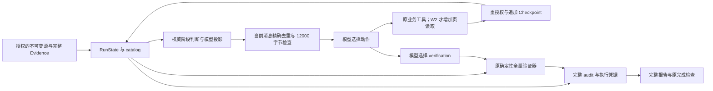

# 持续上下文管理：整合改动方案

**2026-10-08 v6 执行追记：按用户执行v6及继续收尾请求，W2 显式 Parent v6/window/v1/context_read 已完成限定机制与既有案例验收。982离线968通过/14数据库跳过，另行PostgreSQL17/17，真实4/4及零追加回放4/4；实测Token增加20.77%，真实模型context_read为0、超限分页仍未验证。实际结果以[实施记录](CONTEXT_WINDOW_V6_20261007.md)及 STATUS 为准；下方 v6 未实施/不进入 W2 为历史轮次边界。默认、12000、Child v3、原预算和历史原件保持，不进入 W3。**

**2026-10-07 执行追记：用户要求“阅读方案后，执行v5”后，W1b 显式 v5 已完成限定验收。912离线898通过/14数据库跳过，真实4/4及零追加回放4/4；实测整任务Token少11.40%，Runtime增加，真实超限恢复尚未验证。实际结果以[实施记录](CONTEXT_DISCLOSURE_V5_20261007.md)和 STATUS 为准。下方“仅设计/未实施 v5”为此前轮次历史；v6/W2/W3 仍未实施，默认/12000/原预算/历史原件保持。**

原调研日期：2026-10-06；整合日期：2026-10-07（Asia/Shanghai）。**W1a Parent v4 验证前披露解耦已完成限定验收；本轮仅整合后续设计，v5 去重与 v6 分页未实施。** 原调研代码基线为 `f5cf77650763fdc350b7d14d67420273fabe1519`；本文不把历史基线或当轮未实施状态当作当前实现状态。

本文作为持续上下文改动的总方案，整合[已完成的 v4 实施记录](CONTEXT_VERIFICATION_DECOUPLING_20261007.md)和[Parent 去重与按阶段披露详细设计](CONTEXT_DISCLOSURE_DEDUP_DESIGN_20261007.md)。路线为 **v4 验证前披露解耦 → v5 当前消息去重与阶段披露 → v6 有界分页与工作集替换 → 有程序瓶颈证据时才评估 W3**。v5/v6 名称为后续版本预案，实施前冻结；不能原地改变已付费的 v4 wire、Spec 或恢复语义。

目标是在同一 DynamicRuntime 内分开完整证据规模与单次模型输入容量。12000 UTF-8 字节仍按每份实际 system+user 内容计算；执行仍受原决策、工具、Token、deadline/cancel、finish/no_progress、原子根预留及 Parent headroom 限制。Child 继续显式 v3，所有默认和旧协议保持。

本轮只改设计文档与索引，并对已冻结输入做只读设计字节探测；不改生产代码、不发起新模型或金融 Provider 请求、不追加 Checkpoint，不复用已完成 campaign 的额度。下文明确区分已实施 v4 与待实施 v5/v6；设计样例不是可外发协议，也不是 Token/延迟验收。

## 1. 整合路线与版本边界

采用 **权威状态外置 + 程序生成当前决策视图 + 有界证据分页 + 原确定性全量验证**。复用 catalog、codec、Runtime、Registry/Executor、Evidence、Trace、Checkpoint 和根账本，不引入第二套 Runtime 或 Agent 框架。

先解除全量程序验证与全量模型披露的绑定，再消除当前投影视图的冗余，最后处理真正超出单窗的工作集。每轮视图由真实执行状态重建，完整事实与证据留在权威存储，工具从完整已授权输入计算；整理不调用 LLM、不执行业务工具、不重置任务或预算。

| 工作包 | 显式版本与 schema | 交付目标 | 当前状态与推进条件 |
| --- | --- | --- | --- |
| W1a 验证前披露解耦 | Parent v4；`dynamic-context-disclosure-view/v1` | verification 前不再自动展开全 Claim Evidence 闭包；保留完整 verifier 和实际工具执行凭据 | 已实施，四真实运行及零追加回放 4/4；只接受限定披露行为 |
| W1b 去重与按阶段披露 | 拟议 Parent v5；`dynamic-context-disclosure-view/v2`，`phase_gated_verification_brief/v1` | 完整 audit 留在程序侧；就绪时才发送轻量验证集合入口；同一消息内精确 revision 去重 | 本轮设计，不增加分页/动作；先离线安全兼容，再独立冻结真实验收 |
| W2 分页与工作集替换 | 拟议 Parent v6；`dynamic-context-window/v1`，严格 `context_read` | catalog、期间、Fact/Claim inputs、Evidence 可精确分页；读取回执、预算、恢复和反循环规则完整 | 后续独立工作包，v5 稳定后推进，不消费旧剩余额度 |
| W3 验证器内部批处理 | 独立冻结 verifier 规则/回执版本 | 同一次 verification 工具内确定性批处理与全局覆盖证明 | 仅在程序资源或中断重算成为实测瓶颈时评估 |

v3 的 `dynamic-context-view/v2` 是可独立回解旧全视图的精确 metadata 编码；v4/v5 是独立披露契约，不能冒称旧 codec 的等价优化。v5 的完整 revision 表可精确解码当前版本状态，但单份模型视图不能独立还原完整审计/证据；v6 必须通过授权 catalog 与页协议取回完整内容。

v4/v5 不等于 W2 通用分页或无限续跑。只有 W2 真实/机制/安全验收共同满足后，才可声明“在既有预算和 catalog 上限内跨工作集继续”；不能声称无限任务时长或存储。

## 2. 成熟方案调研

来源为 2026-10-06 本轮实际打开的官方文档。这里的“成熟方案”指已有产品或框架采用的工程模式，不等于所有具体 API 均已稳定：Claude 文档明确标注部分 compaction/context editing 为 beta；Letta 所引用的指南位于 v1 SDK 文档。未在本仓库安装、运行或横向评测这些框架。

| 方案与一手来源 | 已有机制 | 本仓库适用性与取舍 |
| --- | --- | --- |
| [OpenAI Compaction](https://developers.openai.com/api/docs/guides/compaction) | 服务端阈值触发或独立 compact 调用，返回携带关键状态的加密压缩项供后续请求使用 | 借鉴“跨上下文边界延续状态”。压缩项不透明，不能作为精确金融事实或可逆证据的唯一载体；本仓库未接入该 API |
| [Claude Compaction](https://platform.claude.com/docs/en/build-with-claude/compaction) | 以服务端摘要替换较早对话；支持按需、阈值和再次压缩等模式 | 借鉴主动整理与循环续跑；LLM 摘要与当前仓库约束不兼容，暂不采用 |
| [Claude Context editing](https://platform.claude.com/docs/en/build-with-claude/context-editing) | 选择性清除旧工具结果并留下占位信息；客户端可保留完整历史 | 借鉴“结果正文外置，保留执行记录和读取入口”；本仓库应使用带授权和哈希的引用，不能仅删旧消息 |
| [Deep Agents Context engineering](https://docs.langchain.com/oss/python/deepagents/context-engineering) | 大工具结果外置，输入保留引用；历史摘要与原始历史存档配合，支持再次读取 | 与本仓库最接近的模式。复用本地 catalog/Checkpoint 替代通用文件工具；不引入框架的任意文件读写、子 Agent 或自动重试 |
| [LangChain Short-term memory](https://docs.langchain.com/oss/python/langchain/short-term-memory) | 线程状态由 checkpointer 持久化；模型调用前可裁剪、摘要或定制视图 | 借鉴“持久状态与模型输入分开”的生命周期。现有 Runtime/Checkpoint 已能承接，无需迁移 LangGraph |
| [Letta Context hierarchy](https://docs.letta.com/v1-sdk/memory/context-hierarchy)、[Compaction](https://docs.letta.com/v1-sdk/messages/compaction) | 区分常驻记忆、按需文件和外部存储；滑动窗口保留近期消息、摘要较早消息 | 借鉴分层与有界常驻状态。指南中的默认摘要模型选择不能照搬，本项目禁止静默替换模型；跨会话自写长期记忆也不在本次范围 |

调研判断：适合本仓库的组合是 **Deep Agents 的外置与取回模式、LangChain 的状态/视图分离，以及 Letta 的记忆分层思想**。OpenAI/Claude 的原生 compaction 可作为未来开放式研究的候选，当前无需迁移模型或 API 才能解决持续工作集问题。

必须区分三件事：减少表示冗余、减少本轮常驻内容、用模型生成语义摘要。当前仓库已较充分实现第一件，也部分实现第二件；本提案补齐第二件的循环、分页与恢复。第三件不属于本提案实施路线。Prompt cache 主要改善成本/延迟，不应当作为绕过 12000 输入检查的方法。

## 3. 实际代码、Token 增长与改动依据

| 代码位置 | 当前核对结果 | 对整合方案的影响 |
| --- | --- | --- |
| [dynamic_protocol.py](../src/stock_research/research/dynamic_protocol.py)，`dynamic_messages` | 每轮只有 system + 当前状态 JSON；唯一工具 Observation 最多 12 项，并非无限累计聊天历史 | 不采用“首轮发任务、后续只发 delta”；每轮必须独立包含任务/范围/当前状态 |
| [dynamic_context.py](../src/stock_research/research/dynamic_context.py)，`build_catalog` / `resolve_catalog` | scope/run/request 绑定、完整对象、可逆 arena 和 C/E/H/O 引用已有 | 复用完整权威存储；引用或哈希本身不授予权限 |
| 同文件 `view_catalog` / `view_verification_catalog` | 旧版本 verification 自动展开全 Claim Evidence；v4 已解除。全部 facts/hypotheses、目录 ID 和来源 periods 仍常驻 | v5 仅去除可避免的披露冗余；大事实/目录/期间/长 inputs 仍需 W2 |
| 同文件 `_verification_manifest` | v4 每阶段生成完整 manifest，且在 `encode_metadata_view` 后追加；空集合、catalog/binding 和相同 revision 重复 | v5 分离完整 audit 与模型 brief，按权威就绪状态披露，不再向所有阶段预发送 |
| [dynamic_context_metadata.py](../src/stock_research/research/dynamic_context_metadata.py)，`_slots` | v3 精确字符串/列表去重未包含 v4 新 manifest | v5 用独立 schema 的 revision 槽位表，保留旧严格 codec 和 wire |
| [dynamic.py](../src/stock_research/research/dynamic.py)，`_context_arguments` / `_check_results` | 从实际 source/calculated/hypotheses/verified revisions 派生执行反馈；v4 还核完整 computed_sources 和真实 verification 凭据 | v5/v6 必须继承 v4 安全分支；阶段不能仅由 Observation 名称或模型 plan 决定 |
| 同文件 `disclose` 分支 | 严格动作、计账、读取前后授权、重复拒绝，业务工具后清除额外选择 | v5 原样保留；仅 v6 新增独立分页动作，不能改变旧完整披露承诺 |
| [verification.py](../src/stock_research/research/verification.py)，`verify` | 完整 pinned datasets 上做独立 Fraction 运算、集合完整性、Evidence 元数据、假设与不足检查 | 模型未阅读全部 Evidence 不影响原程序核验；无需先做 W3 |
| `dynamic.py`，`_verify_computed` / verification / finish / 恢复 | v4 必须有模型实际选择、工具 start/end 成功及完整输入/结果绑定；最终报告另做防篡改重验证 | brief/数量/引用/自动重验证/Child 完成都不能满足 verification required check |
| 消息构建和异常分支 | v4 已区分类型化大小失败，旧分支保留原映射 | v5 保留准确有界停止；仅 W2 对可分页详情投影，不用压缩掩盖 Schema/权限错误 |
| [checkpoints.py](../src/stock_research/research/checkpoints.py) / `_validate_context_history` | Run 锁、追加哈希链、完整 paid wire 重建、未知调用不重放；每事件保存 state | 复用现有存储；每个新版本单独绑定 policy/schema，不迁移旧 run |
| [chat.py](../src/stock_research/model_adapters/chat.py)，`ModelConfig.endpoint` | 当前使用配置端点 `/chat/completions`，未接入供应商原生 compaction | 不添加未经验证的服务端记忆/压缩参数，不换端点或模型 |

历史 Phase 6 v2→v3 精确编码的两案例四运行 Token 少 4.59%，没有证实延迟改善，详见[历史记录](PHASE6_FIRST_ROUND_20261006.md)。后续 v3→v4 验证披露解耦则 **总 Token 32692→36455，增加 3763（11.51%）**：输入多 3573、输出多 190。Child 输入相同，两例各仍为 5 个 Parent 决策；不是增加了决策数量。

| 两案例 Parent 阶段 | v3 实测输入 Token | v4 实测输入 Token | 差额 |
| --- | ---: | ---: | ---: |
| 取源前 | 3163 | 4012 | +849 |
| calculation 前 | 4245 | 5129 | +884 |
| hypotheses 前 | 5713 | 6718 | +1005 |
| verification 前 | 6930 | 6636 | −294 |
| finish 前 | 6148 | 7277 | +1129 |

v4 同状态验证输入确实少 351/323 bytes，但所有阶段新增约 1072–1260 bytes 的完整 manifest，加上模型较长 plan 进入下一轮，抵消了验证阶段的收益。新短 plan 指令只能是提示，不能保证输出或 Token 下降；因此 v5 以每阶段同状态字节与整任务实际 Token 分别验收，不用字节差替代收益。

硬边界保持：Parent 8 决策/12 工具/48000 记账 Token/240 秒；根 16/18/96000；Child v3 3/1/18000/120 秒。catalog 4,000,000 bytes、arena 200,000 节点/深度 32、单次最多 16 引用。真实超限恢复尚未验证；旧 002363 前整改 12325 bytes 不能冒充当前 v3 verification 超限案例。

## 4. 一套权威状态，两种披露层



图中 B→H 是完整数据来源；只有模型实际 verification 动作才能满足该业务执行检查。编视图、生成 audit、统计数量、自动重验证、页读取或 Child 完成都不生成成功凭据。最终输出/恢复仍对完整结果核验，不能只信一个 hash。

| 层 | 权威内容 | 模型披露策略 |
| --- | --- | --- |
| 固定边界 | 原 question、证券/窗口、带时区 cutoff、PIT、snapshot/provider 绑定、来源范围、全部 required checks、版本 | 每轮完整保留；可逆编码，不能依赖前轮已发过或省略原任务 |
| 当前执行状态 | 完整 source/calculated/hypotheses/verified revisions、真实检查、pending/can_finish、预算、DAG、合法动作 | 每轮从 RunState 派生；v5 同一 digest 当前表只出现一次，不能由模型改完成状态 |
| 事实与缺口 | 完整 Fact/Claim/Evidence、假设、冲突/反证/不足、血缘 | v5 原事实/假设及入口保持，verification Evidence 不自动展开；v6 才支持精确分页 |
| 验证审计 | 完整 request/范围/输入 revision/集合内容 hash、完整 computed/datasets 绑定、工具执行凭据 | v5 程序侧保存；就绪且未成功时只发完整集合引用/准确数量，成功后保留执行进度和原 Observation |
| 权威档案 | 原始源、全部对象、历史计划、paid wire、工具/页回执、完整报告 | 原存储保留；每次读/复用/披露/恢复继续授权/PIT/cutoff/snapshot/lineage 核对 |

当前请求是无会话记忆的 system+user 输入，不能跨轮只发差量。最新合法 plan 逐字保留、原 1–5 项×240 bytes 和 plans ledger 不改；system 可建议一条简短当前动作，程序不裁剪、摘要或加入 keep_plan。目标仍受原 2000 bytes 限制。

当前消息 digest 索引只是可逆编码的位置，跨轮可能变化；catalog_ref 保留一份完整 literal 供旧 disclose 回传，binding_ref 保留单份。未来页游标/审计/付费身份必须绑定服务端完整 hash，不能绑定当前短索引，也不能据 hash 命中免除授权。

## 5. W1a/v4 已完成，W1b/v5 最小去重包

### v4 的已完成边界

显式 `dynamic-parent-parallel-v4` / `dynamic-context-disclosure-view/v1` 已取消验证前自动全 Evidence 闭包，保留旧 disclose、完整 catalog、原全量 verifier、实际 `verification_execution` 凭据和严格完整源集合检查。默认与旧 v1–v3 wire/Spec/Checkpoint 不变，Child 显式 v3。同一新 Parent 的 direct/serial/parallel 机制已离线覆盖；限定真实验收为既有 parallel 两案例四运行，不扩启用范围。

最终离线 861 项：847 通过、14 PostgreSQL 跳过、0 失败；该轮专用 Docker 不可用，没有用其他实例代替。真实四运行 4/4、完整事实/证据及合法不足不变、verification 实际执行 4/4、完成后零模型/Provider/Checkpoint 追加回放 4/4。合成 80 行行情/85 Evidence 从 19091→10854 bytes，继续 verify/finish；不能当作真实金融超限恢复。完整失败/跳过/成本见[实施记录](CONTEXT_VERIFICATION_DECOUPLING_20261007.md)。

### v5：audit 外置、就绪门禁与当前消息去重

拟议显式 `dynamic-parent-parallel-v5` / `dynamic-context-disclosure-view/v2`，披露契约 `phase_gated_verification_brief/v1`。仅在现有模块加版本分支，不新增动作、分页、句柄 resolver、跨轮记忆或 verifier 批处理。详细 schema/代码落点见[去重设计](CONTEXT_DISCLOSURE_DEDUP_DESIGN_20261007.md)。

1. 完整 verification audit 在程序/paid metadata/Checkpoint 保留；仅真实生成验证目标后建立，不为未取源的空集合向模型发送 manifest。恢复核全量内容、权威状态、授权和原 wire，不凭模型 brief 验证。
2. `_check_results`、完整源覆盖与 DAG 共同决定就绪：全部必需 read 实际完成，calculation/hypotheses passed，source/calculated/hypotheses revision 非空且一致，computed_sources 覆盖全部当前 outputs，verification 仍未实际成功。不能仅看 `context_next_stage` 或 hypotheses Observation。合法不足不免除验证。
3. 仅此状态发送 `verification_brief`：当前 catalog 中完整 `O:hypotheses` 引用、全部源 `O:*` 引用，及完整 facts/evidence/hypotheses/source_datasets/source_records 准确计数。数量来自完整状态复算；引用不是验证覆盖证明，原工具参数仍为 `refs=["hypotheses"]`。
4. `state_versions.digests` 按字典序保存完整 64 位 digest 的唯一表，source/calculated/hypotheses/verified 槽位用严格 `{"h": index}` 或 null；校验格式、唯一/排序、bool/越界、规范重编码和权威 revision。初始 source 空状态 digest 仍保留，pending reads 才表示尚未读取，不把 digest 存在当完成。
5. 保持 catalog_ref 一份完整 literal 和 binding_ref 一份；brief 继承当前绑定，不复制 request/content/collection hashes。此为新披露契约，不是旧完整 manifest 的模型侧等价回解。

| 当前阶段 | v5 每轮保留 | 验证专属内容 |
| --- | --- | --- |
| 取源前/中 | 完整任务/范围/checks、实际 read 进度、缺口、权威 revision/DAG、合法动作 | 不发空集合验证 manifest |
| calculation 前 | 原来源/目录/绑定、完整性状态与精确工具 refs | 不提前发验证集合和内容 hash |
| hypotheses 前 | 原完整事实、假设所需引用、缺口/冲突/反证和合法动作 | 不发待验证 manifest，不引入事实页 |
| verification 就绪且未实际成功 | 当前状态、完整声明假设状态/原因、合法 verification | 一份轻量 brief；Evidence 正文按旧 disclose 自选 |
| verification 成功后的 finish | 全部检查、真实执行进度/原 verification 结果、未解缺口 | 不重复发送待验证 manifest |

就绪后若模型选择 disclose、格式纠错或提前 finish，下一轮仍带必要 brief；“减少反复发送”不是只发一次后依赖记忆。源/派生状态变动使旧就绪失效，按原业务重算规则处理。hypothesis conflicted/insufficient 及反证入口原样保持，不归并成成功。

### v5 编译与准确停止

派发顺序为原授权/PIT/cutoff/snapshot/lineage/未知状态检查 → 权威阶段判断 → 完整 audit 与模型投影分离 → 当前消息精确去重 → 序列化实际 system+user → 原口径 `sum(len(content.encode('utf-8')))` ≤12000 → 原局部/根预留 → paid intent 持久化 → 外发。所有 JSON、表、说明、brief、plan、错误反馈均计入。

相同状态、版本、计划和 disclose 选择必须得到相同 wire。v5 不做 fit 裁剪或自动翻页；其他必需输入仍超限时保留原准确有界上下文停止，不创建 context_read 候选。原 1–5 项 plan/parser/ledger、finish/no_progress、原子根预留/headroom、deadline/cancel、未知付费不重发不释放均保持。

### 设计字节探测；不是 Token 收益

原冻结 v4 两案例 10 份 Parent 输入重新核授权/PIT/oracle/SHA 后，纯 JSON 样例移出完整 manifest、按消息去重 revision、仅两份就绪输入加 brief。任务、plan、事实/假设及其余内容保持，system 暂留 v4 以隔离正文变化。

| 阶段 | 603207 v4→设计样例 bytes | 688184 v4→设计样例 bytes |
| --- | ---: | ---: |
| 取源前 | 7217→6298 | 7217→6298 |
| calculation 前 | 8562→7642 | 8581→7661 |
| hypotheses 前 | 10483→9503 | 10295→9315 |
| verification 前 | 10358→9503 | 10255→9400 |
| finish 前 | 11144→10046 | 10867→9769 |

合计 **94979→85435，少 9544 bytes（约 10.05%）**，各份少 855–1098。记录 `.runtime/context-dedup-design-byte-probe-20261007.json`；该未实现 schema 的样例不是合法 v5 wire，未验证 codec/parser/恢复或实际 Token、延迟、金融质量。真实收益要在实施后用整任务父子实测 Token 重新验收。

## 6. W2：分页、读取回执与循环续跑

### 所有会增长的集合都必须处理

需要分页的对象包括 catalog IDs、Observation 的 Claim/Evidence 列表、来源 periods、Evidence 详情，以及单个 Claim 的长 inputs。例如最大回撤只有一个数值，但其输入可覆盖整段价格序列；把一个 Claim 当作不可拆的“完整闭包”仍可能超限。

新窗口可展示 Claim 的精确 name/value/unit/formula/window/available_at，加 `inputs_ref`、有序输入数量和内容摘要哈希；inputs 列表本身按页读取。该对象明确叫“Claim 投影”，不能当成原完整 Claim 写回业务状态。完整 inputs 的次序、重复规则及全部源字段在 catalog 中保持，验证器仍读取原对象。

目录也按页提供，不能把所有短 ID 永远保留在 prompt。窗口头部放授权内 catalog 根、各类型对象数量、当前页及后续入口。没有展示某对象不意味着删除它或不存在。不能以相似度检索挑选几个“相关证据”冒充完整集合。

### 提议协议

W2 另用拟议显式 Parent v6 / `dynamic-context-window/v1`，继承 v5 的 audit 外置、阶段 brief 与当前消息精确去重，再增加页能力。保留原 `tool`、`parallel`、`finish` 业务协议；严格 `context_read` 仅属于 v6。旧 v1–v5 及旧串行版本的 `disclose` 按原协议保持，不能原地改变其完整披露承诺。新动作有两个互斥形态：`action,catalog_ref,cursor,plan` 读取已发游标，或 `action,catalog_ref,refs,plan` 请求 1–16 个已知对象的分页视图；禁止同时给 refs 和 cursor 或添加其他键。游标形态例如：

```json
{
  "action": "context_read",
  "catalog_ref": "CURRENT_CATALOG_SHA",
  "cursor": "ISSUED_PAGE_TOKEN",
  "plan": ["读取下一页已绑定证据"]
}
```

以上为 schema 示例，不是可执行请求。cursor 是由 Runtime 生成并已在本 run 当前 paid 窗口登记的固定长度字符串；绑定 scope、run、request、catalog、window_ref、对象 revision、集合、稳定排序起点与 policy 版本。请求同时核当前窗口的已发 cursor/ref 集合与完整 catalog membership；猜出隐藏对象 ID 也不能直接读取。不得接受任意路径、SQL、URL、自由过滤条件、模型自报权限或新 cutoff。token 的存在或哈希正确不能授予访问权。

digest 表索引只在当前窗口有效，不进入 cursor 身份；cursor/页回执绑定服务端完整 revision/content hash。完整 verification audit 留在程序侧，不在每页重复发送；需要时沿用当前就绪 brief。

cursor 固定“从哪里继续”，不预先承诺一个无论下轮头部多长都必须装入的页长度。读取时使用已收到的 plan，以及原子提交后的真实下一轮 decision/工具/预算/状态头部，含 next cursor 和实际页回执字段，预编译下一窗口后确定片段终点；页结果显式含 `has_more`、集合总数和本片段范围。提交前必须证明该片段加真实控制头部可装入；最小合法原子项仍装不下时明确失败，不无界细切标量或生成空页循环。页回执提交后不得悄悄修改切片边界；后续错误/拒绝反馈增大使已承诺页不再 fit 时准确有界停止，其他处理规则需独立冻结。

按对象读取保留最多 16 引用限制；大 O/C/H 引用在新动作下返回首个完整片段及明确续页入口，不冒充整个对象已展示。模型只能使用当前目录中登记的 refs/cursor；服务端按 catalog 检查完整 membership，不必把整个 known_refs 列表塞入 prompt。旧 `_context_parse_arguments` 通过构建全量 view 获得引用的路径不得复用为新页的必经步骤。

### W2 的确定性窗口编译

W2 在 v5 控制头部基础上，再按固定优先级装载：不可省边界/状态 → 模型实际请求页 → 当前阶段事实页 → 可选预览。同级按 canonical ID/原列表次序，不用相似度选择几条证据冒充完整集合，不主观删除反证。

先核授权与未知状态，再编最小控制头部，按稳定次序尝试合法原子项/片段；只有连同真实 system、plan、codec 表、brief、计数、游标和错误反馈都装得下才加入。装不下则给准确未展示数量/入口；最小合法必要项仍超限时类型化停止。优先装入不是静默裁剪，页回执明确集合总数、实际范围和 has_more。

容量来自 `12000 - 本轮实际头部字节`，不引入 80%/85% 阈值或 Telemetry 路由。算法最多遍历原 catalog 节点上限；头部变化时允许确定性回退，每次严格减少装入项数并检查原 deadline/cancel，不能无界 while 再压缩。同一状态/版本/计划/页选择得到相同 wire；最终检查通过后才预留和派发。

### 事务、恢复与无进展

页读取依次执行原预算检查、工具计账、`tool_started` 持久化、授权读取、读取后授权与时限检查，再原子保存页回执及工作集选择。读取回执至少绑定：

```text
scope_ref / run_id / request_ref / catalog_ref / policy_version
object_revision / collection_ref / ordered_slice / content_hash
turn / tool_call_id / selection_before / selection_after
```

完整页结果可由不可变 catalog 和区间重建，页状态不复制整份 Evidence。新窗口快照记录 `window_ref`、实际 message SHA、展示/外置计数以及与最近业务状态的关系。`window_ref` 哈希的核心描述排除自身字段、游标 token 和 actual message SHA，避免窗口→游标→窗口的间接循环；实际 wire SHA 另行保存。cursor 绑定签发窗口的核心描述，并核当前 paid 窗口登记的允许集合，不绑定当前 digest 短索引。固定派发头部、页选择、模型请求哈希与付费 intent 在同一 Checkpoint state 中绑定。自动编译过程只是本地计算，不能虚构一笔模型读取动作。

恢复重建当时的 catalog、窗口、页内容及全部 paid wire，核对 trace/工具回执/权限；新策略使用独立 state schema 分支，旧恢复代码和身份不升级。发生业务状态变化后重新生成目录；旧 cursor 明确失效，不能在新 catalog 中使用旧 `C:F1` 位置碰巧匹配。对象绑定除 source revision 外还要包含 calculated/hypotheses 内容哈希，因为仅 source revision 不足以区分某些派生状态变化。

首次合法新页读取与现有首次成功 `disclose` 一样可算读取进展，但不满足任何 research required check。签名覆盖实际对象版本和规范化切片，并保存已读成员/区间集合；重新组合全由已读成员组成的不同页也不是新进展，不能只按页哈希去重。重复读取已完成切片继续拒绝并计 `no_progress`，不能通过换游标、改列表顺序或重新压缩绕过。业务状态改变后的新内容另作新读取。对同一版本已移出的旧页进行再次读取，首版仍受重复拒绝规则限制；不承诺任意来回翻页。若以后需要允许重读，应独立设计“可展示但不算新进展”的协议，不能本轮顺便放松规则。

本地视图重建不增加模型决策，也不清零 `no_progress`、工具用量或 deadline；`context_read` 消耗原模型决策和一个已计账读取工具尝试。两次重复无进展仍停止。未知模型或工具结果沿用原停机规则，不自动重发。可以在尚未建立 paid/tool intent 时重算纯视图；不能把这条用于重跑已启动但结果未知的读取。

### 预算意味着能继续多久

现有成功 parallel 路径一般是 Parent 5 个决策：parallel、calculation、hypotheses、verification、finish。按原 8 决策上限，在没有修正/失败且其他额度足够时最多剩 3 次额外模型决策；这只是上限，不保证能读 3 页。新页读取还受到工具、根账本、Token 和绝对 deadline 限制。

新版本应把原 `_parent_headroom` 的“待执行业务检查 + finish”原则延伸到可选页读取前，避免为看细节耗尽完成步骤的最低决策/工具余量。未就绪来源和 DAG 依赖也要计入剩余必要动作。Token 无法预知实际输出，不能声称保证完成；继续使用原保守预留与实收结算。额度不足时不给出虚假的可执行翻页候选；模型仍选择业务工具，不由 Runtime 自动完成。

如果不可省略的业务工作本身超过原总预算，返回准确的预算终止状态。本设计不会以创建新 run、自动延长 deadline 或不断分段接力规避上限。更长时段的任务预算属于独立规划议题。

## 7. W3：大规模核验分批设计，以及为什么不优先改它

当前 verifier 完全在程序内运行，12000 模型字节上限不限制它的输入。W1/W2 保留其全量实现，模型选择一次 verification，Runtime 对完整 computed/datasets 执行原 `verify`，原 required check 与最终报告重验证均保持。因此上下文分页无需先把 verification 变成多次模型动作。

只有程序核验的内存、计算时延或中断重算成为实测瓶颈才考虑 W3；提示词变大、模型 Token 上升或分页增加本身不是启动理由。如果满足该条件，再实施**同一次 verification 工具内的确定性批处理**，不增加 Agent 或把每批变成付费模型轮次。拟定方案如下：

1. 从完整 pinned datasets 和当前 calculated/hypotheses 对象生成 VerificationManifest；绑定 scope/run/request、snapshot、完整内容 revision、verifier 规则版本。expected 集合必须独立由源重建，不得仅根据 computed 中已有事实建立，否则遗漏事实也可能通过。
2. 分别登记需要检查的源记录、Evidence、Claim、event anchor、假设和不足诊断。每批记录有序成员、输入哈希、规则版本、逐项结果及错误；批间读取继续授权，不能把哈希匹配视为授权。
3. 避免错误地按行情日期切分原公式。收益率、最大回撤、事件前后窗口等跨分片规则必须在完整闭包上计算；必要的流式聚合状态要证明与现有 Fraction oracle 等价。首版可以只按 Claim 分组且保留完整序列，先不改数学实现。
4. 汇总时检查完成批的成员集合与 expected 完全一致、无重复、无额外项、无 stale revision，并执行原全局检查：事实集合完整、Evidence 来源关系、假设与 anchor 一致、合法不足语义等。批数相同或 counts 相同不是覆盖证明。
5. 只有全部批和全局检查都成功，才提交一次原 `verified_revision`、verification Observation 和继承 v4 的真实 `verification_execution` 凭据；凭据绑定本次模型动作、工具 start/end、完整输入/结果及规则版本。缺批、失败、篡改、中断或过期都不能标 passed，批数量或 hash 不替代实际工具执行。
6. 初版批回执只用于覆盖审计，不用于绕过当前未知 `pending_tool` 的禁止重放规则。已知完成的验证按原回放处理；中途崩溃而工具结果未知仍停。若需断点续算，必须另行版本化纯计算恢复契约，不以“幂等”擅自重新执行未知工具。

W3 的验收 oracle 为同一源、同一请求下的原 verifier 及独立预期结果，所有字段/失败类别等价。最终报告生成时现有重验证也不能悄悄改成只信一个 receipt hash。未满足等价验证前，W3 不替代原实现。

## 8. 安全、兼容与版本化停止

每次编视图、披露、缓存/状态复用、验证、最终输出和恢复继续原权限/PIT/cutoff/snapshot/lineage 核对；新版本继承 v4 完整源集合和读取/重验证末尾源复核，不回退到旧弱执行检查分支。目录、计数、页边界、执行摘要也可能泄露，须授权后生成。SourceGrant 撤销不能靠只发引用绕过。

catalog/view/window/cursor 均绑定本 scope/run/request。模型不得写入权威状态、扩大来源或改 cutoff；来源正文、错误、模型 plan 不能升格成系统指令。完整旧协议、paid identity/wire、Spec、Checkpoint、冻结文件和历史失败/分母保持。新日志不读取本地秘密，`test_api.txt` 不打印、复制、提交或进入 Artifact。

| 情况 | v4/v5 | W2/v6 额外能力 |
| --- | --- | --- |
| 非必需验证 audit 重复或提前发送 | v5 移至程序侧，按权威就绪状态发 brief | 沿用 v5，不在每页恢复整份 manifest |
| 必需事实、目录、期间、Claim inputs 或旧 disclose 闭包超限 | 原准确有界停止，不静默裁剪或假装分页 | 合法片段和准确游标/数量，完整原对象保留 |
| 原任务/不可分割标量/固定必要头部仍超限 | 原类型化上下文失败 | 拟议 `partial/context_minimum_view_exceeded`，不裁剪用户要求 |
| catalog 存储/结构达到原上限 | 原错误，不声称无限存储 | 同原上限，页不能绕过 |
| 重复/两次无进展、决策/工具/Token/deadline/cancel | 原规则；编视图不能重置 | 页同规则，额外 headroom 不得削弱 |
| 未知付费或工具结果 | 停止、不重发、不释放未知预留 | 页工具未知也不自动重放 |
| Schema/hash/权限/PIT/快照/恢复篡改 | 按原验证/安全错误拒绝 | 同规则，禁止再压缩试错掩盖 |

W2 新错误码及 state schema 在实施时冻结并纳入报告映射，当前 CLI 没有这些能力。默认旧入口保持原 `dynamic_context_budget_exceeded` 语义，不升级旧 run。

## 9. 最小代码落点与交付拆分

| 区域 | W1b/v5 拟议最小改动 | W2/v6 再扩展 |
| --- | --- | --- |
| `dynamic_context.py` | 分离完整 verification audit 与纯模型 projection；权威就绪 brief，保留 catalog | 页投影、inputs_ref、目录/期间/对象片段与完整计数 |
| `dynamic_context_metadata.py` | 独立 view/v2 revision 槽位 codec，旧严格 codec 不改 | 复用当前窗口的精确表；页身份不依赖表索引 |
| `dynamic_protocol.py` | 显式 v5 builder/system；原业务 action/parser/plan 保持 | 显式 v6 window builder 与严格 context_read parser |
| `dynamic_contracts.py` / CLI | 显式 v5 Spec/policy 身份，默认/Child v3/原限额不变 | 另加 v6，旧 disclose 承诺及身份保持 |
| `dynamic.py` | 继承全部 v4 执行凭据/完整源/授权/恢复分支，按真实 checks 门禁 | 页工具计账、选择/回执状态、重复区间、headroom 与故障恢复 |
| `checkpoints.py` / Trace | 优先不改物理存储，v5 audit/policy/paid metadata 与原 wire 绑定 | versioned window/页回执，追加哈希链与 Run 锁保持 |
| `context_telemetry.py` / report | 实际每阶段字节、brief/hash表/audit 外置计数；原完整最终报告 | 每页范围/覆盖、读取次数、窗口替换/恢复审计 |
| 纯 `context_window.py` / `context_pages.py` | v5 不需要新模块，优先现有纯函数 | 仅 W2 若复杂度需要再拆辅助模块，不建新 Runtime |
| `verification.py` | 不改原数学、集合完整性与 full computed/datasets | W2 仍不改；W3 单独冻结并证明等价 |

按 W1b → W2 独立收口。每包先完整离线、安全/恢复与历史 wire 回放，再冻结同源同请求的真实验证及新 campaign；不混入下一包，不复用历史余量。必要 direct/serial/parallel 兼容使用同一新 Parent，旧入口原样保持；不扩大并行启用范围。

## 10. 验收分层；字节与真实成本分开

v4 的已执行结果为 861 离线/四真实运行，详见 §5；以下 v5/v6 均为**待执行**验收，不计入 v4、历史 828 或任何真实分母。

| 类别 | W1b/v5 必须证明 | W2/v6 追加证明 |
| --- | --- | --- |
| 分阶段披露 | 未就绪/成功后无完整 manifest；就绪 brief 入口/数量精确；错误/提前 finish 后仍正确重建 | 每窗口保持同门禁，不把页回执当执行 |
| 精确编码 | full digest 解码与权威 revision 一致；null/初始空 source 语义不变；乱序/重复/bool/越界/伪造拒绝 | 跨窗索引不串用，游标仍绑定完整对象版本 |
| 输入边界 | system+user 每份≤12000；中文、标点、最长合法 question/plan、12000/12001，其他必需输入超限准确停 | 至少两次替换；目录/期间/Evidence/单 Claim inputs 超单窗可分页，最小不可装项有界停 |
| 事实与工具 | 原完整 Fact/Evidence/假设/缺口/反证/血缘及 verifier 输入不变；篡改数值/来源/引用/时间/漏事实拒绝；verification 必须实际成功 | 页遍历重建原集合完全一致、顺序/成员精确，不把模型阅读率当程序验证率 |
| 完成语义 | 早 finish、重复动作、合法 insufficient、未完成保持；brief/引用/生成视图/自动重验证/Child 完成不能替代执行 | 只翻页也不能完成检查，换游标/顺序不重置 no_progress |
| 权限与不变性 | 撤权、跨 scope/run、陈旧 revision、快照变化、恢复篡改和 complete source 遗漏拒绝 | 读取前后/恢复撤权，删页/重排/重复伪覆盖与陈旧 cursor 拒绝 |
| 预算与恢复 | 原 root/headroom/deadline/cancel/未知paid保持；完成后零模型/Provider/Checkpoint追加回放；v1–v4 wire/默认不变 | 页 intent/receipt 故障点恢复、未知页不重放，必需业务及 finish 余量保持 |
| 路径兼容 | 同一显式 v5 的 direct/serial/parallel 及旧入口机制 | 同一显式 v6 的三路径和页动作组合 |
| 性能 | 同状态每阶段实际 system+user 字节不增加；整任务父子 input/output/total Token 实测，不由字节推算 | 额外页决策/工具/Token、编译/读/验证/模型耗时、Checkpoint体积全计 |
| W3 条件项 | v5/v6 不执行 W3 | 有瓶颈证据时独立证明分批与原 verifier/全局预期等价，缺批/跨修订拒绝 |

离线命令保持：PowerShell `$env:PYTHONPATH='src'`，然后 `python -m unittest discover -s tests -v`。数据库仅专用隔离实例；跳过、失败、合成机制与真实金融验证分列。历史审计和相同 Run 锁测试串行，避免重复 Windows 锁问题。

合成扩量不能计金融真值或真实模型超限成功。实施后先只读预检合法真实超限材料；没有则明确真实超限/分页未验证，不能改问题或填假 Evidence。真实验收另冻结已有合法 request/source/grants/oracle、版本/Child v3、顺序/评分、运行上限、新预算；本设计不预授权其外发，不复用 v4 四槽或 Phase6 剩余额度。

质量门槛为零事实/检查损失、零越权/超限外发/未知重发和原预算内闭环。报告所有失败与合法不足；不按成功样本删失败。性能用整任务实测 input/output/total/accounted Token、决策/工具、逐轮 system+user 字节、模型 I/O 与 Runtime；嵌套耗时不重复相加，金额无端点价格/账单时未知。分页或新 plan 可减少单轮输入却增加总 Token，不能仅凭验证阶段/正文比例宣称收益；小样本不报 P95 改善或统计优势。

## 11. 本轮交付与明确停止边界

2026-10-06 原轮完成官方资料调研、源码只读审查与设计索引，未实施新机制、未新跑完整 unittest/真实模型；当轮文档记录与 Phase6 历史结果保留。2026-10-07 后续单独授权并完成 W1a/v4，861 离线结果、四运行/零追加回放与所有失败/跳过详见[实施记录](CONTEXT_VERIFICATION_DECOUPLING_20261007.md)，真实超限恢复尚未验证。

本次整合将原拟议 v4 窗口/context_read 拆到未实施 v6，保留已冻结 v4 含义；W1b/v5 只做 audit 外置、就绪 brief、当前消息精确去重及短 plan 提示，不带分页。本文与[详细去重设计](CONTEXT_DISCLOSURE_DEDUP_DESIGN_20261007.md)、PLAN/STATUS/ARCHITECTURE/CONSTRAINTS 同步，设计字节样例少 10.05% 仅说明正文潜力，不是实际 Token/延迟改善。

本轮验证为文档链接/版本/围栏、diff 检查及冻结代码/测试/历史付费材料/Checkpoint 的只读完整性核对；结果留在 `.runtime/context-integration-design-validation-20261007.json`。未实施 v5/v6、未重跑其不存在的功能测试、未追加模型/金融 Provider/Checkpoint 或 campaign。

完成设计后停止。下一实施包应先独立完成 v5 的离线/兼容/安全与有界真实验收，再决定 W2；W3 只由程序瓶颈证据触发。LLM 摘要、跨任务长期记忆、更大上下文/预算、新模型/端点/Provider/Dataset/领域 Agent、无限续跑均保持范围外。
