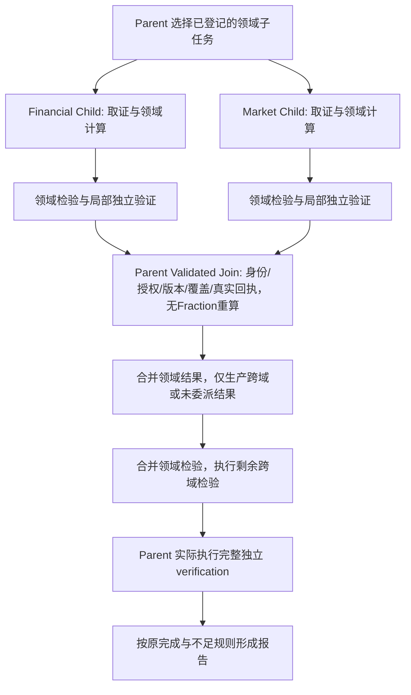

# 领域 Child 分析职责改进方案

2026-10-09 最终交付：工程①–④及限定真实Child闭环完成；原603207正常和688184合法不足的A/B/C最终canonical结果均与原完整oracle等价，6格覆盖6/6。原新窗口评分保留初始4/6、复验1/2；用户另授权688184/B独立一次v4补验，6决策/20074 Token、真实Final后insufficient通过；共9次运行6/9通过，失败未删除。C每例实际域计算2次/4算子、局部Fraction2次、Join重复生产/Fraction0、原完整Final1、独立完整性审计19保留。全部当前58 API请求用量已知139565 Token；A24841/B55656/C59068含失败修正，C较B高6.13%、较更强A高137.78%，无实用收益或有意义自主检查增量证明，保持显式实验及原默认。core1159门禁哈希一致、隔离PG16通过，旧39与新8＋补验1＋前轮3只读回放一致。全历史旧API未知22338＋局部Root4095预留保留，实际总费用未知。详见[最终报告](DOMAIN_CHILD_ANALYSIS_FINAL_REPORT_20261009.md)；没有发布、部署、来源扩张或下一阶段。

2026-10-09 新独立窗口已获明确授权：原2案例/6初始＋最多2有据复验/128父子决策/768000记账Token/首次freeze起2400秒。上轮16:27:09–17:07:09（+08:00）实际外发11次全部已知17900 Token；正常A实际Final完成，B两次非法parallel按no_progress停止，C入口将Financial在途预留误判为terminal unknown，Market未HTTP外发即拒绝，原Root4095预留不释放。修复已离线通过，待启动续验因自动审批usage limit未执行；原窗口已过期。新入口对全部A/B/C统一legal-action-selection/v2，修复在途/terminal区分；传输12＋新入口11离线通过，core保持原1159门禁。保留旧API未知22338＋旧局部Root4095合计26433预留、全部deadline和失败。当前准备新正式freeze，尚无本窗口新paid。详见[验收报告](DOMAIN_CHILD_ANALYSIS_ACCEPTANCE_20261009.md)。

2026-10-09 verification数据续验实际结果：15:49:29冻结、16:29:29绝对截止（+08:00），原两案例、六A/B/C槽及质量标准不变。前三次DeepSeek请求成功，财务/行情/计算已执行并生成7 Fact/12 Evidence；第4次于15:50:13–15:50:34连接失败、用量未知，立即停止新增paid（3/4=75%，无重试）。实际hypotheses/Final未执行，B/C等五槽未启动、复验0，第二轮和goal仍未完成。新known3659/accounted12203/未知8544保留；全历史加独立探针known10090/accounted32428/unknown3，未知预留22338不释放。工程本地门禁保持1159＋隔离PG16、传输8、driver9；只读partial1/1回放无模型/Provider/Checkpoint追加。无真实Child/强基线收益结论，继续保留显式实验模式；详见[验收报告](DOMAIN_CHILD_ANALYSIS_ACCEPTANCE_20261009.md)。

2026-10-09 最新用户授权“直接使用verification中的数据发给deepseek，完成原来第二轮实验”，覆盖此前本实验的停止重试指令。沿用已完成工作包和原两案例A/B/C同题标准；只复用verification绑定的合法不可变源与完整计算输入，通过原授权Tool Observation披露，不把verified元数据当最终执行。旧campaign/续验已过期，旧两个未知请求及13794 Token预留、失败和截止时间保持；同范围续验另冻结新身份、账本与2400秒起点，仍2案例/6初始＋最多2有据修复/128决策/768000记账Token。只显式使用同端点同模型direct-ipv4/v1传输实例，默认和源码身份不变。当前在离线门禁及续验准备，尚未产生新的真实闭环证据。

2026-10-09最新用户停止条件已满足：续验网络请求4/5成功（80%），两业务campaign合计4/6成功（66.7%），当前可见失败均为ModelConnectionError。按“超过60%就不要再重试”停止所有进一步paid重试/新campaign；此前重试草案授权由最新指令覆盖，第三目录未创建、第三轮paid0。未知2次及13794 Token预留不释放。HTTP/模型请求成功率不等于业务闭环：实际Final/B/C/Child仍未完成，goal未完成；详见[报告](DOMAIN_CHILD_ANALYSIS_ACCEPTANCE_20261009.md)。

2026-10-09续验结果：新campaign已于14:24:43正式冻结（截止15:04:43，+08:00），603207/A前四模型动作/Tool成功，第5连接失败且用量未知；Root partial、实际Final0，B/C五槽未启动、修复0。新known6417/保守记账15387（含8970未知预留）；加旧4824未知记账与独立14已知Token，跨批known6431/accounted20225/unknown2，实际总费用仍未知。已停止所有新paid、不重发、不释放；partial1/1零追加回放。六个无凭据代理TLS样本1次SSLEOF支持间歇性连接故障，不能证明未计费。完整业务闭环、Child自主选择与强基线收益仍未验证，goal未完成；详细证据见[本轮报告](DOMAIN_CHILD_ANALYSIS_ACCEPTANCE_20261009.md)。

日期：2026-10-08（Asia/Shanghai），2026-10-09职责调整。状态：**①–④工程本地通过；⑤已冻结，首个真实请求连接失败/用量未知，业务与收益验收阻塞，goal未完成**。原仅设计授权已由当前 `/goal` 覆盖；原历史交付记录保留。

当前实现与实际证据见[2026-10-09验收报告](DOMAIN_CHILD_ANALYSIS_ACCEPTANCE_20261009.md)：完整1159项0失败/错误、跳过的16数据库项另在隔离实例全部通过、39历史零追加回放一致。本地六路径证明完整结果等价、Child真实工具计算及Fraction局部验证、Join零重复生产/Fraction、Parent实际最终完整验证；其合成模型动作不能证明真实Agent收益。独立2案例/6槽campaign仅1次未知请求、4824保守记账Token，余5槽未启动，未知预留不重发不释放。

2026-10-09续验：原freeze的2400秒绝对期限已过；新的分阶段诊断及独立连通性请求证实当前端点路径可用，旧unknown仍无权威回执。用户明确授权沿用同两案例/原五包的新独立campaign，使用新run、账本、正式freeze与同上限计时，不重启实现、不扩业务、不中止旧未知记录或复用额度。续验驱动只复用既有验收控制器，Runtime/Spec/核心代码与原质量不改；目前新正式freeze/paid尚未执行。

2026-10-09 用户要求沿用当前实施进度，局部消除Join重复验证。当前责任链固定为Child Read → Calculation → Domain Review + Fraction Local Verification → Parent Validated Join → Composition → Cross-domain Checks →实际完整 Final Verification → Finish。以下第7、9节按此修订；案例、预算、工作包、质量与安全标准不扩展。

方案初稿时用户要求“让领域 child 有实用价值，设计改进方案”，当轮仅设计、真实实现仍为来源Child v3及Parent v1–v6。随后当前goal正式授权五包实施：把两域Child扩为有界领域分析任务，Parent消费完整结果；10-09再调整可信Join职责。新能力使用显式实验身份，默认/旧运行不改，不复用历史campaign，不扩大金融Provider或采集。

## 1. 决策与实用价值

推荐先下放**完整领域子任务**，再验证是否需要 Child 的模型循环。单次读源继续由 Parent 直接调用普通 Tool；步骤完全可预先确定的领域任务使用确定性领域 Tool；需要在授权目标内依据缺口、口径和反证选择下一项检查的任务，才选择分析 Child。三个入口使用同一组业务算子和证据契约，不能靠弱化直接路径来证明 Child 有用。

Child 的交付从“源数据 + 已读取”改为“可核查的领域 Fact/Claim、Evidence、领域检验、缺口、反证、完整执行回执”。Parent 合并这些结果，只生产跨域与未委派部分，保留最后的完整独立 verification。Child 内模型只选择受限算子和检查，不编写公式、不补数值、不改支持状态，不用自由文字作为金融事实。

以下条件同时成立才认为职责下放有实际意义：

1. Child 真正执行领域计算和检验，而非只读源或生成分析措辞。
2. Parent 实际消费这些结果，不再生产同一组领域 Claim/检验。
3. 每个结果可从已授权不可变源、实际工具执行和独立算术核对重建。
4. 全任务质量不退化，包含父子模型、协调、重授权和验证的总成本可检查。
5. 使用模型的 Child 还须证明检查选择或依据反馈调整有价值；固定“read → calculate → finish”仅证明计算职责转移，不证明 Agent 的增量收益。

## 2. 原设计时基线与不能直接放开权限的原因

| 当前事实 | 改进的直接含义 |
| --- | --- |
| Financial/MarketRequest 固定 evidence 目标、空 hypotheses；Child 仅有本域读取工具，3 决策/1 工具/18000 Token/120 秒 | 必须新增显式分析请求和 Spec，不能原地修改 v3 |
| Child required checks 仅 read；结果只有 sources、引用、状态及用量 | 增加计算、领域检验、局部验证的真实执行检查和结构化结果 |
| Parent 将 Child sources 重新核对后导入普通源 Observation，再运行完整 calculation/hypotheses | 增加结果消费与所有权，避免重新生产领域结果 |
| 当前全量 calculate 无条件处理 market_daily，纯财务子集会产生行情缺口 | 提取域内算子，不能简单调用 calculate(financial_subset) |
| 当前 Child finish 取最后一个 tool_finished 作为 source tool call | 新版必须分别绑定 read、calculation、review 的实际回执，避免计算调用被误当源读取 |
| 原最终 verify 对完整 expected Claim 集严格核对 | 分域合并必须保持完整集合、原公式/值/ID/期间/缺口；独立验证不能拿 Child 自报通过代替 |

实现依据：[请求与 Spec](../src/stock_research/research/dynamic_contracts.py)、[Child 与 Parent](../src/stock_research/research/dynamic.py)、[计算](../src/stock_research/research/calculation.py)、[领域检验](../src/stock_research/research/hypotheses.py)、[独立验证](../src/stock_research/research/verification.py)、[并行协调](../src/stock_research/research/parallel.py)。

Phase 5 三题的总 Token 为 direct 43588、serial 54881、parallel 59352；原功能 8/9、修复另列，未观察到 Multi 质量增益。这些是历史来源 Child 的非盲小样本结果，不能作为新分析 Child 的成功证明，也不能与缺 verification 的失败运行比较等质量速度。详见[原评估](PHASE5_EVALUATION_20261006.md)。

## 3. 最小业务范围

只升级已有 Financial/Market 两域，深度 1，每域最多一个 Child。不新增 Provider、Dataset、Benchmark/Announcement/News/Calculation Child，不引入 Router 模型或另一套 Runtime。

| 责任方 | 首轮复用的已有能力 | 继续保持的语义 |
| --- | --- | --- |
| Financial Child | 最新可见财务核心值、收入/归母净利润正基数同比；financial_deterioration；同期间现金流背离 | 累计合并口径不当单季/TTM；缺值不当零；期间不匹配保留不足；mixed directions 保留冲突 |
| Financial Child 的显式可选 profile | 已有 absolute_profit_change 金额变化算子及检验 | 只在任务事前明确授权金额检验时提供；不能替代原百分比同比或把非正基数不足改写成同比通过 |
| Market Child | 观察区间价格变化、最大回撤、因子调整价格变化、交易日对齐、mechanical_adjustment | 未复权与因子调整分开；不是总收益；对齐失败保留缺口；不声称排除全部公司行动 |
| Parent | 未委派域、股票与基准对齐及比较、market_direction、事件锚点/前后行情、event_chronology、跨域合并、最终完整 verification | Market Child 没有 index_daily 权限；事件涉及其他来源时不下放；描述性支持不升级为因果 |

首轮以财务同比与行情检查实现职责下放；金额变化复用已有算子，但进入独立显式 profile，不把旧请求自动改成新目标。利润率、ROE、TTM、任意新风险模型和新闻自由解读均不纳入首轮。

## 4. 新版本与职责边界

已实施身份采用业务名称，避免与既有上下文 Parent v6 混用：

- `financial-analysis-child-v1`、`market-analysis-child-v1`：新 Child Spec/消息/恢复身份。
- `domain-analysis-task/v1`：可信应用构建的子任务契约。
- `domain-analysis-result/v1`：完整分析结果与回执。
- `dynamic-parent-domain-analysis-v1`：能消费分析结果的新 Parent，显式启用。

现有 Child v1/v2/v3、Parent v1–v6 的默认、wire、Spec、paid identity、Checkpoint 和行为保留。新模式在 configuration 中绑定 Parent/Child/task/catalog/result 版本及完整请求 hash；恢复原运行必须使用原配置，禁止以升级版本重置额度。

新 Child 可见本域 source Tool、版本化 `calculation` 和 `domain_review`。`domain_review` 已实施为确定性适配工具：执行已批准的域内假设规则，并对当前领域结果作独立局部验证；两项形成绑定实际调用的执行凭据。最终 Parent verification 仍单独由模型实际选择并成功执行。首轮不把现有 Child 自动继承 Parent v6 分页能力；必需精确视图超过 12000 字节时仍 typed 停止。

## 5. 子任务请求：把目标下放，而非只传数据域

Parent 模型选择可信应用事前登记的 `task_ref`；Runtime 展开和重查授权。不得让模型填写任意证券、cutoff、窗口、来源、权限、公式、阈值或预算。

根目标 profile 及是否包含金额问题由可信应用在首次模型决策前绑定。Parent 选择 task_ref 只选择已冻结目标的执行责任/路径，不能在运行中换 profile 来增删根问题、必需 Claim 或检查。允许的多条执行路径必须完成同一个冻结目标。

`domain-analysis-task/v1` 必须含：

| 字段组 | 内容与约束 |
| --- | --- |
| 身份与范围 | root/parent/task/domain、原证券、带时区 cutoff、PIT、原绑定窗口/Provider/不可变快照、源 envelope/hash |
| 目标 | 固定 `profile_id`、任务问题、必需 operator/check IDs、事前允许的可选 operator/check IDs；只能来自版本化目录 |
| 完成要求 | required output coverage、必需 read/calculate/review 执行检查、允许合法不足的规则；模型不能删检查 |
| 权限 | 可信应用/父有效委派/服务策略/Child Spec 的交集引用；每次执行与恢复实时重核，不把 hash 当授权 |
| 资源 | 显式新局部上限、根分配 ID、继承的绝对 deadline、取消关联、12000 UTF-8 字节 |

任务 profile 同时规定最终 Claim 集和缺口语义。为保持原完整 verifier，主 profile 必须覆盖原任务在该域应有的所有 canonical 结果，不能只返回模型觉得重要的几项；模型的重点选择只影响执行顺序、允许的补充检查和最终展示引用。

首轮模型决策前冻结根 expected 集合的生成规则/oracle、假设、缺口语义与执行检查集，实际结果集合由已绑定不可变输入和确定性规则决定。模型不能决定漏做必需项；前提不成立时须由实际算子回执产生合法不足。金额变化使用事前明确绑定既有 `profit-change/v1` 能力的独立显式 profile，不能在执行中给原请求添加金额 Claim 后仍声称原完整 verifier 无需适配。金额 profile 一旦选定，其计算和检验同样是必需项。

## 6. 领域循环与可审计的决策空间

业务算子已按现有能力拆成有界组合：`financial_snapshot`、`income_yoy`、显式 `profit_amount_change`、`market_price_window`、`factor_adjusted_window`；具体算子不接受任意表达式。

新版本保持严格 JSON 文本动作。source Tool 仍 `refs=[]`；calculation 仅接收当前已授权源 Observation 引用与允许的 operator 引用；domain_review 仅接收当前 calculated revision 和冻结的领域 check 集。引用由本轮目录发放并绑定任务/输入版本，不允许模型提供事实值或未知 ID。旧 parse_action 协议不变，新 Spec 才启用新的 refs 契约。

一个 Financial 子任务的预期循环：

1. 读取绑定财务数据，得到实际源回执。
2. 按目标选择允许的计算组合，生成完整核心财务 Fact/Claim。
3. 根据结果选择完成同一冻结目标的计算组合、执行顺序或允许的诊断。若所选金额 profile 要求金额检验，必须执行并在同比非正基数不足旁另列金额变化；不能决定省略该必需项。原同比不足始终保留。
4. 执行 domain_review，产生领域检验与独立局部验证回执；计算 revision 变化后旧 review 失效。
5. 模型请求 finish；Runtime 核对全部必需执行检查和结果覆盖，再提交结果。

Market 同样可依据是否具备对齐因子选择执行顺序/合法计算组合，并诚实保留日历/因子缺口。已冻结的因子调整检查不能因看到缺因子而被模型直接跳过；由算子执行产生实际不足回执。只有一次 source 读取仍足够时，额外读取原样内容仍是重复无进展；模型不因成为分析 Child 获得扩窗、refresh 或新快照权限。

补充算子改变实际计算内容或合法检查状态才算进展。改写 plan、重复 review、读取已完整披露的内容和重复同一 operator/input 均不算进展。若当前合法 profile 的全部步骤仍可完全确定，路由应选择确定性领域 Tool；不能拿固定流程截图证明 Agent 价值。

## 7. 计算与验证的拆分方式

1. 从现有 calculate/study/hypotheses 中提取域内纯算子；原 calculate 与 calculate_study_claims 保持兼容包装，旧结果逐字段、顺序、Claim ID、Evidence ID、公式、缺口核对。不能给 Financial 增加不存在的行情缺口。
2. 生产计算复用 Decimal 与现有输入选择/口径；数值由程序产生，模型不直接输出数值结果。
3. 新局部 verifier 只检查子任务范围内 expected projection、源绑定、值/单位/期间/完整集合和既有假设规则；数值期望继续来自独立 Fraction 路径，不用生产计算作为 oracle。
4. Child 内局部通过仅证明当前子任务检查通过。Runtime生成绑定源版本、input revision、实际read/calculation/review调用、task/Spec/ownership与完整结果manifest的不可变凭据。Parent Validated Join重授权，并从实际Checkpoint哈希链重建凭据，核验身份、PIT/cutoff/snapshot、源/结果哈希、血缘和必需覆盖；对凭据完整且仍有效的结果直接消费，不再调用领域生产算子或Fraction逐项重算。缺失、伪造、失效或无法重建的凭据拒绝；不能信模型自报verified。
5. Parent 最后仍对合并后全部 Fact/Claim、Evidence、事件与假设执行现有完整 verify。原 verify 本身不放宽、不省略、不以局部结果覆盖。

必须消除Parent同域生产和Join重复Fraction；保留来源授权、完整性、血缘与真实回执核对，以及原最终完整独立验证。恢复从持久执行重新核对凭据，input revision变化使相关凭据失效。实际Child生产/局部验证、Join、Final与恢复审计次数和耗时分别记录；未实测不宣称性能提升。

## 8. 结果契约与血缘

`domain-analysis-result/v1` 由 Runtime 从已提交状态生成；模型不能直接填写它。至少包括：

- domain/task/request/profile/spec/catalog identity、source envelope 与完整输入 revision。
- 完整源附件引用、source read receipt、来源 Tool/Provider 调用和原授权/PIT/快照信息。
- 全部 canonical facts/claims/evidence、公式/单位/期间/inputs、gaps、counterevidence。
- 已执行的 operation/check ID、输入/输出 revision、实际 tool_started/tool_finished 回执、局部验证回执。
- 执行检查、领域假设状态、结果覆盖 manifest、结果 digest、Trace/Checkpoint 引用及局部/根用量。
- 展示用 conclusion refs 和 gaps/counterevidence refs；只可引用已验证对象，不增加自由数值、因果解释或模型摘要事实。

执行状态与研究结论分开：合法完成全部计算/检验后，假设仍可 insufficient/conflicted/unsupported。未执行必需工具、非法动作、预算耗尽、取消或未知付费结果是执行 partial/failed，不能因“没有结论”伪装成合法不足。

原 Claim/Evidence 字段和 canonical ID 不新增模型文字或 run ID。来源读取血缘继续指向实际 read call；计算/局部 review/委派调用使用旁侧执行凭据关联，禁止把最后一个调用误写为 source_tool_call_id。对象相同的哈希可去重，内容冲突或语义冲突须报错/显式保留，不能 last-writer-wins。

完整结果留在不可变附件和 RunState；Parent 模型接收精确结构化结果视图与引用，不默认复制 Child 全部过程或原始数据行。沿用已验收的无损视图能力，每次披露仍重授权；模型不见的完整源仍必须参加程序验证。页面/摘要/引用不是执行凭据或 finish 依据。

## 9. Parent 真正消费结果

程序事前建立 `check_ownership` 和 `claim_ownership`：每项根检查/结果归一个已登记的域或 Parent，依赖显式固定。不能由模型声明已完成或移除所有权，也不能 Child 与 Parent 各生成一份后任意取其一。

新版 DAG：每域 source → domain calculation → domain review → parent validated join；全部必需域 join 后才能 compose → cross-domain checks → final verification → finish。直接/确定性领域 Tool 路线按同样 ownership 产生结果与真实回执，保持同题完整目标。

Parent 的旧 calculation/hypotheses 检查不能被“收到了 Child”自动标 passed。新 Parent 为 composition/check aggregation 记录本地实际工具凭据，并逐项链接 Child 已核验的执行凭据；最终 verification 仍要求本地真实动作成功。下游 revision 绑定 join 集、域结果 digest 与跨域源：任一输入变化都令对应 computed/hypotheses/verification 凭据失效。原 v4–v6 的本地执行约束在旧版本保持原样。

Root 缺口诊断仍按原完整请求执行；源状态/warnings、必需但未绑定的数据、事件锚点不足与其他域缺口不能被 Child 展示结果覆盖。域内“不适用”不等于根任务“不需要”。合并遵守原 canonical 顺序；源/派生对象及缺口集合的相同内容可精确去重，不能有损摘要或按模型偏好删除。

Parent 重授权读取与全量 verifier 会继续处理完整源。减少的是 Parent 模型接触中间数据与重复业务生产步骤；总 Token/CPU/IO 是否下降必须测量，不能由模型输入更小推断。

## 10. 预算候选与安全边界

旧 Parent 8 决策/12 工具/48000 Token/240 秒、旧 Child 3/1/18000/120 秒及全部历史根限制保持不变。当前goal分析版已按以下候选分配显式实现，离线和真实门禁独立验收；不提高任何原根上限、不更改默认。

优先在原双域根 16 决策/18 工具/96000 Token 内重新分配：分析 Child 每域至多 5 决策/4 工具/18000 Token/120 秒，新 Parent 至多 6 决策/8 工具/48000 Token/240 秒。常规 Child 使用 read、calculation、domain_review、finish 四决策，留一个决策给额外已授权计算或格式修正；无法在此限制内完成则诚实 partial，不能偷用 Parent 余量。

按现 root-budget/v3 的语义，这一候选最大决策为 `6 + 2×5 = 16`，工具为 `8 + 2×4 = 16 ≤ 18`，Token 为 `48000 + 2×18000 = 84000 ≤ 96000`。Parent 的 8 工具已含两个 AgentTool 包装调用，不能再次把它们加到整根最大值。并行先记包装 2，组预留为 Child 操作 8 加包装 2；`_parent_headroom(additional_tools=2)` 保留 Parent 剩余工具 6。因此根工具占用为包装 2 + Child 8 + Parent 剩余 6，余量不自动分配给 Child。

当前已用离线实际账本事件验证原子预留、包装尝试、headroom和恢复结算；真实模型完整路径仍未验证。配置不符合原根限制必须拒绝，不自动增加额度。Token 仅是账本上限，不证明每个 12000 字节输入都能支持五轮；当前单轮 reservation 可能达 13280 Token，已用实际 Token 加下一轮预留可能使 finish 也无法派发。每次派发仍检查剩余额度，失败与未知预留计账，不能把加法成立写成真实流程预算已验收。

新 Parent 并行常规链约五决策，六轮上限只留一次修正；直接细粒度链约六决策时没有纠错余量。因此比较基线 A/B 保留其原 Parent 8/12/48000/240 秒能力，不人为降为 6/8。分析 C 的 6/8 是为了在原根上限内给 Child 分配份额；该比较是完整路线的实际资源取舍，不是同 Spec 下仅改变一个变量的因果实验。需要不同局部配置时事前冻结并完整披露。

继续保持同一 DynamicRuntime/Registry/Executor/Evidence/Trace/Checkpoint；Parent 是根账本唯一写者，一次持久原子预留全部 Child 最大局部用量并保留父 headroom，之后才启动 Worker。depth=1，每域唯一；Child 禁止 spawn/任意代码执行。

所有读、缓存、算子输入解析、披露、join 和恢复重授权；PIT/cutoff/窗口/快照/来源不变。Derived available_at 按原规则精确等于全部实际输入 available_at 的最大值，并满足根 cutoff；涉及合格事件锚点时保持原锚点参与最大值的规则。Parent/Child 取消和嵌套绝对 deadline 保持；迟到结果不可导入。新 Spec 保持 no_progress_limit=2、output_tokens=1024、严格有界 JSON 和原 finish 拒绝机制，不因多给决策轮数放宽这些停止规则。

一旦获知任一付费模型结果或 Child 整体结果未知，根运行停止新增付费派发，已派发分支按取消/deadline 收尾；未知预留不释放，恢复不重发。只允许安全核对/保留本地已知结果，不能把该 partial 当完整成功，未知 Child 分支不能走直接路径重读来伪装恢复成功。

resume 需要对 task/operator/check 版本、原请求、实际 paid/action、源/派生回执、结果 hash、ownership、完整附件和根账本逐项重核。已知完成未 join 可幂等导入；已 join 不重复导入 Claim、Evidence 或结算预算。Child output 已持久化而 Parent 崩溃、两个结果反序到达、域 result 被协调重哈希篡改都必须受真实 intent/源/独立 verifier 检查约束。

## 11. 三种执行方式与选择边界

| 方式 | 适合任务 | 不允许宣称的收益 |
| --- | --- | --- |
| Parent 普通 Tool | 一次取数、一个指标、直接完整流程已足够 | 不为覆盖 Agent 数量强制委派 |
| 确定性领域 Tool | 固定的取证/计算/领域 review；无模型自主判断必要 | 可证明职责封装或并行收益，不能冒称 Agent 推理收益 |
| 分析 Child | 授权目录内有多项检查选择，需依据缺口/反证调整，领域中间过程确实复杂 | 不凭“多轮模型”宣称分析更深、更准、更便宜 |

确定性领域 Tool 是现有 Executor 上的有界适配器，不建立独立 Runtime/调度系统。内部 read/calculation/review 的实际执行、权限与根工具尝试全部记录，不能把多次内部调用藏成一次计账来偏袒基线。模型 Child 使用同一算子/输入/结果 schema。

首轮路由显式选择 profile 与模式；Parent 可在冻结允许集内选择直接或委派，没有第二个 Router 模型、不改变默认、不调启用阈值。单证券长问题、“为什么”和双域出现本身不是充分委派条件。缺数据时先如实返回不足，不能用增加 Agent 代替合法来源。

## 12. 实施顺序与接入点（当前goal已授权）

| 包 | 最小交付 | 必须先证明的结果 |
| --- | --- | --- |
| 1：算子边界 | 提取 Financial/Market 域内纯计算/检验、独立局部验证适配；原全量兼容包装保留 | 旧事实/公式/ID/顺序/缺口与历史零追加回放一致；纯财务无行情伪缺口 |
| 2：完整领域结果 | 新 task/result/ownership、确定性领域 Tool、Parent 合并与最终 verifier | 同请求得到完整原 canonical 结果；实际没有 Parent 重复领域生产，执行回执可恢复核对 |
| 3：Financial 分析 Child | 新显式 Spec/消息/refs/checks、有限模型选择与反馈，先串行；旧 v3 保留 | 至少领域 calculation/review 实际发生；结果由 Parent 消费，非法/重复/预算/恢复保持 |
| 4：Market 与并行 | 同模式加入已有 Market；复用 root-budget/v3 与显式依赖 DAG | 两个领域分析过程可并行、根原子预留/父 headroom/取消/迟到与 canonical merge 正确 |
| 5：实用价值验收 | 冻结相同任务和三种方式的定向比较，选择有收益的 profile | 安全与完整性全通过；Child 对强基线有事前定义的可量化收益，否则保持显式实验或使用 Tool |

这些包是同一设计的拆分，当前goal已明确授权逐包完整实施，并保留原Phase4历史结果。先做确定性接入证明计算职责可安全下放，再用同任务强基线判断哪些profile值得增加模型决策；10-09验证职责调整纳入当前②–⑤，不另起方案。

实际接入点：独立`domain_analysis_contracts.py`（新请求/Spec/checks）、`domain_analysis_protocol.py`（新动作/精确视图）、`domain_analysis_execution.py`（执行/凭据/可信Join）、`domain_operators.py`（纯域生产/局部适配/消费）；原`calculation.py`/`study.py`/`hypotheses.py`/`profit_change.py`复用算子，`verification.py`保留完整验证并新增独立局部适配，`dynamic.py`及`parallel.py`只按新版本接入，`root_budget.py`原账本保持，CLI/report提供显式入口和完整结果。独立适配模块减少对旧身份/wire的影响，仍只有原DynamicRuntime/Registry/Executor，未另建Runtime/Router。

## 13. 验收方案与否决条件

### 离线与历史

- 用 `PYTHONPATH=src` 执行 `python -m unittest discover -s tests -v`；数据库测试使用专用隔离实例，跳过须另列。
- 算子拆分前后全量旧输出与所有历史冻结 case/hash/paid wire/恢复身份核对；不重写旧 oracle/失败分母。
- 强制证明两个域都产生实际派生 Claim 和 review，Parent 没有再次生产域结果；root verifier 完整 expected 集一致。
- 覆盖撤权、跨域/operator 越权、单位/期间/PIT/修订冲突、Claim/Evidence 省略或伪造、source/derived 调用归因、协调重哈希、重复与 no_progress、unknown、取消、迟到、crash/resume、反序 merge、超 12000 停机和根 headroom。
- 局部合法不足与执行不完整分别测试；原百分比同比不足不能被金额变化替换；unsupported/conflicted/反证不能被展示压缩遗漏。

### 已冻结的独立真实验收与保留标准

先从已有合法快照中挑选代表性 profile 并只读确认：完整财务方向检查；非正基数/缺期/期间不匹配的真实合法不足；行情因子/日历分支；两域联合任务。合成夹具可覆盖选择/缺口，但不能冒充真实金融输入。如果现有快照没有合法多步选择或反证案例，则明确该能力未做真实验证，不扩数据或改 cutoff 来凑题。

事前冻结 source/request/grants/cutoff/oracle/全部 required checks、三种方式配置、运行顺序、成功定义、资源上限、模型端点/标识与源码 hash。金额 profile 仅在原任务明确包含金额目标时进入同目标比较；不能拿不同问题或少返回结果的路线做成本比较。

每个比较组同请求、同算子、同原始可见数据与根上限；父子全部 paid/失败/修正计账。所有失败保留。恢复与 zero-network replay 单列，不把同案例重复当独立任务。当前goal已授权有界外发，首轮在完整离线/安全/历史gate通过后冻结2案例/6初始槽＋最多2复验、128决策/768000记账Token/2400秒，未复用旧额度。首请求连接失败且用量未知后已停止新增付费；完整plan、指标、预算和阻塞见验收报告。

| 层次 | 验收内容 | 否决条件 |
| --- | --- | --- |
| 安全与完整性 | 每次读/复用/恢复授权；完整 Claim/Evidence/缺口/反证；实际计算/review/final verification；根/局部预算与恢复一致 | 任一越权/PIT/源/血缘/未知重发/遗漏或凭据问题，不接受该 profile |
| 职责下放 | 可定位 Child 实际业务计算与领域 review；Parent 消费；同目标的全部 expected 结果保持 | Parent 仍完整生产同一领域结果，或 Child 只返回源，视为未解决问题 |
| 自主决策 | Trace 有与任务目标和工具反馈对应的有效检查选择/调整，不是格式循环；与强确定性 Tool 比较 | 只多了 read/calculate/finish 包装，不能宣布 Agent 收益 |
| 实用收益 | 同质量总根 Token、完整 wall、模型 I/O、协调/授权/生产计算/独立验证开销、人工补证需要分别比较 | 父 Token 降低但总账更高不能称成本下降；不等质量失败不能称加速 |

建议事前采用“某一明确 profile 的所有冻结案例完整质量/安全通过，并在无质量退化时总 Token 或完整 wall 至少下降 10%”作为小样本效率候选门槛。比较对象必须包含事前指定的有效确定性领域 Tool 基线 B，并核对有效 A/B 中更强的结果；只优于 A、却劣于 B，不能据此宣布分析 Child 实用。campaign 还须事前固定使用整组总根 Token或哪种完整配对 wall 聚合规则，不能事后择优指标或只挑收益案例。

本轮已冻结整组完整Root Token（含失败/复验）对有效B至少减少10%且核对更强有效A/B为主指标，wall另列；10%不是实测结论或全局自动路由阈值。本轮不改为质量收益指标。若未来独立授权的目标是质量而非效率，应提前另冻结相对同一强基线的可核查漏检/未完成减少目标及可接受成本上限，不能看到结果后换指标。只有几例时只报告本批配对结果，不宣称 P95、统计优势、广泛准确率或 Provider 验证。

能力通过而实用门槛未达，允许保留显式实验模式；确定性领域 Tool 是默认候选，不能因已写完 Child 就自动推广。金额/单域/双域/并行的结论分别声明，未执行的模式不随另一模式通过而算通过。

## 14. 设计依据与来源边界

- [Anthropic：Building effective agents](https://www.anthropic.com/engineering/building-effective-agents)，2024-12-19，2026-10-08核对。其区分预定 workflow 与由模型根据反馈控制步骤的 Agent，强调根据可测结果决定是否增加复杂度。本方案据此设置确定性强基线和自主决策验收；不是引入其框架或当前托管产品。
- [LangChain：Subagents 官方文档](https://docs.langchain.com/oss/python/deepagents/subagents)，2026-10-08核对。其把多步领域任务/上下文隔离作为适用场景，并指出简单单步或开销超过收益的任务不适合委派。本项目仅借鉴任务边界，精确结果、授权/PIT/快照、预算和完整 verifier 继续由本仓库契约保证，不采用其默认自由摘要或新增依赖。
- 本仓库 [架构](ARCHITECTURE.md)、[约束](CONSTRAINTS.md)、[计划](PLAN.md)、[实际状态](STATUS.md)、[Phase5实际评估](PHASE5_EVALUATION_20261006.md)、[v6限定结果](CONTEXT_WINDOW_V6_20261007.md) 是当前实现与历史结果的权威依据。公开 Agent 模式不证明本项目金融数据、收益或安全已经通过。

## 15. 原仅设计轮交付记录（历史）

本轮只新增本设计并同步 ARCHITECTURE/CONSTRAINTS/PLAN/STATUS 的当前设计索引；业务源码、测试、历史报告、paid wire、Checkpoint、冻结 artifact 和模型/金融 Provider 运行不改。文档链接/围栏/Mermaid、范围/版本/预算表述和 diff 检查作为文档 QA；不以原 982 离线或 17 数据库测试数字声称新分析 Child 已通过。本设计尚无实际收益或新真实模型证据。
