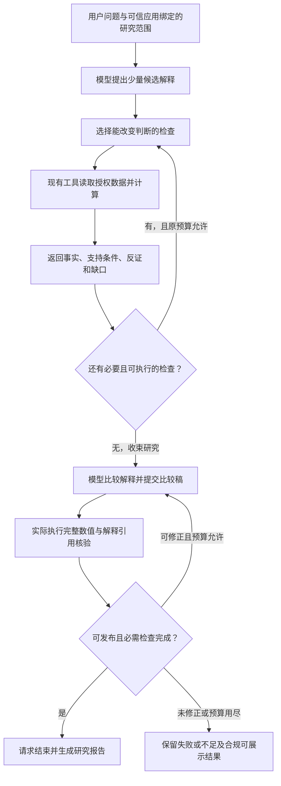
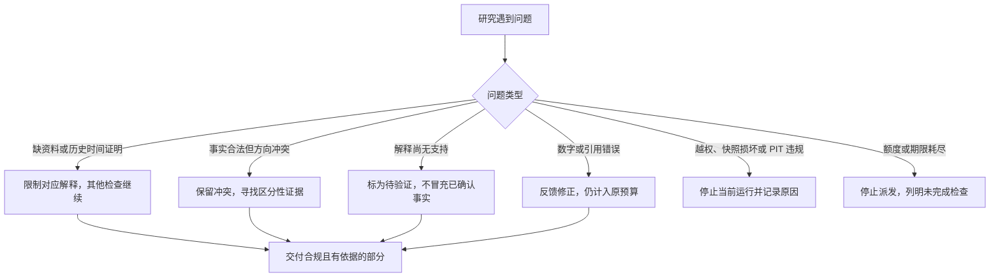

# 业务阶段四：多因素解释研究最小实现方案

日期：2026-10-12（Asia/Shanghai）
状态：**实现设计已形成，业务代码尚未实施，正式案例集尚未建立，新实验尚未启动。**

本文的“阶段四”指股票研究业务中的综合研究与可能原因分析，不是仓库研发计划中的 Phase 4。本文落实本次会话已讨论的架构升级方向，供后续实施使用；编写本文不改变当前默认行为、历史协议、实验授权或预算。

## 1. 目标与首版交付

在已有财务同期比较和历史行情分析之上，使 Agent 能够提出少量候选解释，利用授权资料检查支持与反证，比较解释之间的关系，并说明仍然无法判断的部分。

用户最终应看到：

1. 这段价格表现有哪些已核实事实。
2. 哪些可能解释与现有证据相容，哪些受到反证。
3. 哪些证据只是几种解释共同符合的事实，哪些有助于区分解释。
4. 多种解释能否共同作用，是否仍无法区分。
5. 如果继续研究，哪项证据最值得检查，以及它会怎样改变判断。

首版不要求证明历史因果关系，不要求选出唯一原因，也不要求先补齐所有金融数据。**缺少一种证据通常只限制对应解释；其余有价值的分析继续。**

本方案采用会话后续明确的分工：模型提出、比较和调整解释；程序计算数值、检查来源与时间、核对引用和完成条件。早期“确定性解释审查”表述在本文中仅指可机械核对的部分，不把全部金融推理改写成固定规则。

### 1.1 什么叫“有用的比较”

相对于输入的阶段三指标，至少产生一项有依据的新增研究判断：

- 反对或缩小一个具体命题的适用范围，而不把局部反证扩张为对整个机制的否定。
- 说明两个解释分别适用于哪些观察，指出共同证据和区分性证据。
- 说明多个解释可以共同作用，或现有证据不能区分，并具体指出缺少什么。
- 新证据到来后，合理改变解释评价、优先追查顺序或下一项检查。

仅罗列指标、列举通用因素、重复“证据不足”，或者把券商观点换一种说法，均不自动算成功。资料足以支持比较而系统仍笼统拒答，应计为功能失败。

### 1.2 首版范围

| 首版必须做 | 可选增强，不能成为首版前置条件 |
| --- | --- |
| 单股、明确价格窗口、带时区的信息截止时间 | 任意自然语言实体解析和自动补齐研究范围 |
| 复用收入/归母利润同比、价格变化/回撤、已有基准/因子/现金流检查 | 毛利和费用分解、量价统计、PE/PB、行业归因 |
| 少量候选解释、证据关系、比较结论与后续检查 | 广泛公告正文抽取、历史行业归属、外部实时搜索 |
| 主 Agent 配合现有确定性工具 | 新领域 Agent、独立 Router、新 Runtime、RAG、向量数据库 |
| 实际检查、引用核验、合法不足、可回放报告 | 严格因果识别、贡献比例估计、交易决策 |

首版优先接入直接工具路线。Financial/Market Child 继续保留现有显式入口，其既有结果可作为后续复用对象；不把新解释协议同时移植到全部串行/并行历史版本作为首版交付条件。

## 2. 现状依据与复用边界

| 当前模块 | 可复用内容 | 本次需要补上的内容 |
| --- | --- | --- |
| [study_contracts.py](../src/stock_research/research/study_contracts.py)、[dynamic_contracts.py](../src/stock_research/research/dynamic_contracts.py) | 可信请求、固定研究范围、必需检查、预算 | 新解释任务的版本化说明与可选检查目录 |
| [calculation.py](../src/stock_research/research/calculation.py)、[profit_change.py](../src/stock_research/research/profit_change.py) | 确定性数值与来源引用；显式利润金额变化 | 小型检查适配，不更改公式或旧输出 |
| [hypotheses.py](../src/stock_research/research/hypotheses.py) | 固定描述性规则及支持/反证/不足 | 规则结果与解释的对应关系；不能直接把规则 supported 当原因成立 |
| [tools.py](../src/stock_research/research/tools.py)、[scoped.py](../src/stock_research/research/scoped.py) | 已授权绑定快照读取、逐次授权 | 在原范围内选择可选检查；不自动采集或更换快照 |
| [domain_operators.py](../src/stock_research/research/domain_operators.py) | 已拆分的领域计算和结果组合 | 用作检查工具的实现基础，不增加另一套计算引擎 |
| [dynamic.py](../src/stock_research/research/dynamic.py)、[dynamic_protocol.py](../src/stock_research/research/dynamic_protocol.py) | 逐轮决策、反馈、真实执行检查、恢复和预算 | 显式新协议下的候选解释、证据反馈、比较稿和完成凭据 |
| [verification.py](../src/stock_research/research/verification.py) | 独立 Fraction 算术、完整来源/数值核验 | 附加解释的引用、关系格式、时间资格和遗漏检查 |
| [report.py](../src/stock_research/research/report.py) | Markdown/JSON 报告、缺口与执行记录 | 面向读者的解释比较表，区分数值验证与解释评价 |

当前 Parent 的 `synthesis` 主要按假设状态分组，不是竞争解释审查。当前普通假设状态复核使用生产 `test_hypotheses` 函数；独立数值核验不能代替独立金融语义评审。

真实基线以 [2026-10-09 领域 Child 最终报告](DOMAIN_CHILD_ANALYSIS_FINAL_REPORT_20261009.md) 为准：两案例最终 A/B/C 六格覆盖完成，但初始 4/6、窗口内复验 1/2、另行补验 1/1 的历史分母保持；共九次运行六次通过。实际 Child 路径尚未证明有意义的自主检查增量或实用成本收益。更早固定研究已经有基准、现金流、利润金额及限定事件时间案例，不能只按最新两案例认定整个系统的能力。

旧报告中的测试数和通过记录均是历史证据，不能写成本方案已通过测试。新解释能力需要自己的运行证据。

## 3. 术语说明

| 术语 | 本文中的具体含义 |
| --- | --- |
| 任务契约 | 程序可读的任务说明：股票、窗口、资料范围、必需检查和输出字段。它是普通数据结构，不是额外审批流程，也不是预先写好的答案。 |
| 候选解释 | 尚待检查的猜想，例如市场共同变化、基本面压力。允许提出时尚无支持，但必须明确所需证据。 |
| Evidence／证据 | 可回查的来源记录、附件、数值、版本和时间信息。 |
| Claim／可核对陈述 | 从已绑定来源得到的事实或计算结果。现有数值 Claim 保持原语义，模型解释另存。 |
| PIT／时点限制 | 只使用研究截止时点允许知道的信息；public 和 system 的现有差异保持。 |
| 不可变快照 | 固定本次使用的数据版本，使以后能复现，而不随供应商改数改变旧结果。 |
| 确定性检查 | 用程序执行固定公式或核对规则；相同合法输入应有相同结果。 |
| Runtime／运行器 | 执行模型选定动作、记录实际结果、控制预算和结束条件的现有程序。 |
| Spec／profile／协议版本 | 显式选择的一组任务能力和消息格式；新增版本不覆盖旧版本，也不自动成为默认值。 |
| Registry／Executor | 已登记工具的目录与执行入口；模型只能选择目录内且已获授权的动作。 |
| Trace／Checkpoint | Trace 记录执行经过；Checkpoint 保存可核对的状态，用于中断后恢复。 |
| revision／版本号 | 指明这份输入、结果或比较稿是哪一次修订，防止用旧验证结果批准新内容。 |
| verification／finish | 前者实际执行核验，后者请求结束；说“检查通过”不能代替运行检查。 |
| campaign／验收批次 | 预先固定案例、运行次数、预算和期限的一组实验，失败和复验均保留。 |
| paid wire／付费请求身份 | 原模型请求内容及关联身份，用于追踪费用和防止恢复时重复发送；本文不修改旧身份。 |
| 共同证据 | 几种解释都可以容纳的事实，本身不能区分解释。 |
| 区分性证据 | 对不同解释产生不同影响的证据；需要说明为什么，而不是仅贴上标签。 |
| 验收参考答案 | 已核对事实、关键反证、合理判断范围与禁止越界的评分依据，不是一篇必须照抄的研报。 |

## 4. 运行流程与职责



| 责任方 | 负责 | 不负责 |
| --- | --- | --- |
| 可信应用 | 固定问题范围、允许工具/资料、必需检查和预算 | 预写金融答案；每一步重复向用户请求许可 |
| 模型 | 提出解释、选择检查、解释证据差异、调整研究、撰写比较 | 发明数值、扩大权限、改截止时间、删除必需检查 |
| 业务工具 | 读取和计算，产生可核对的结果 | 判断某个历史原因已被证明 |
| Runtime | 调用与计账、真实执行回执、状态/恢复、完成条件 | 因模型自报“已完成”跳过检查 |
| 程序 verifier | 核对数值、引用、时间资格和结构一致性 | 仅凭引用存在就认证金融解释合理 |
| 独立评审 | 在验收或抽查中判断解释是否合理、有用、越界 | 作为每次普通运行的人工审批关卡 |

候选解释与下一步动作合并在同一轮响应；最终比较稿与实际 verification 请求合并。首版不为每个解释新增一次模型调用，不新增常驻“评审 Agent”。

## 5. 模型可以探索什么

首版建议同时维护两到三个实质不同的候选解释；新 Spec 的候选容量初始上限为三个。该上限是拟议的新功能范围，不改变旧运行限额。候选解释可以修订或替换，修订历史保留；不能靠重复改写措辞取得运行进展。

模型可以：

- 自行选择相关解释及其描述，不要求逐字使用固定答案。
- 从已登记检查目录中组合检查、调整顺序、依据新证据改变重点。
- 提出尚无可执行检查的解释，明确记录缺少什么；这类解释不能伪装成已有支持。
- 判断解释可以共同作用，或现有证据不能区分；不强制选唯一赢家。
- 在全部必需检查已处理后，因继续检查无价值、资料不可得而收束。

模型不能把“解释可以自由提出”扩张为“任意公式、任意新事实或任意外部访问”。首版仅执行可信应用允许的检查。行业、估值、访谈或公告正文等超出当前能力的线索进入后续证据需求，不自动启动新采集。

优先追查顺序表示“接下来查什么更有价值”，不是原因概率或因果贡献排名。没有证据时，不输出虚构的置信百分比或因素贡献百分比。

## 6. 最小数据结构

以下名称为拟议实现名称，当前代码中不存在；所有例子是字段说明，不是已执行结果。保留原 `StudyRequest`、Claim、Evidence 和历史序列化，仅在显式新版本中添加解释层。

### 6.1 解释任务说明 `ExplanationRequest`

| 字段组 | 内容与来源 |
| --- | --- |
| `base_request` | 原可信应用构造的研究请求；证券、绑定、cutoff、PIT、固定必需假设均不变 |
| `research_target` | 解释哪个实际价格窗口与表现；若用户假定下跌但工具算出上涨，明确指出，不编造下跌原因 |
| `required_checks` | 原必需检查加候选处理、比较提交、解释核验；在首轮前冻结 |
| `optional_check_catalog` | 允许探索的现有工具/算子、所需绑定、适用条件；授权工具不等于全都必做 |
| `explanation_profile` | 独立版本与字段边界；建议名 `financial-market-explanation/v1` |

输入完整时直接运行；只在证券、时间等无法可靠确定且确实影响执行时澄清。普通证据缺口通过结果反馈，不变成逐步人工批准。

### 6.2 候选解释卡 `ExplanationCandidate`

| 字段 | 含义 |
| --- | --- |
| `candidate_id`、`revision` | 稳定身份及修订版本，由 Runtime 绑定，不代表金融可信度 |
| `statement` | 解释的具体内容，区分宽机制与可检查的狭义命题 |
| `check_refs` | 引用允许目录中的检查；没有对应工具时明确 unavailable |
| `support_conditions`、`counter_conditions` | 预期什么观察会支持或削弱解释；属于模型研究建议，不是新计算公式 |
| `evidence_links` | 绑定已存在 Claim/Evidence/check 结果及关系：支持条件、反证、背景或共同证据 |
| `missing_requirements` | 缺少的字段、时点证明或数据覆盖，以及它影响哪个判断 |
| `next_check` | 下一项检查、可执行性、不同结果会怎样改变解释；允许为无 |

程序根据真实检查派生 `condition_results`、时间适用性和来源完整性。模型只能给出 `interpretation_assessment` 等解释评价，不能写入或覆盖上述程序字段。

“收入与利润同比均下降”是一个可检查条件；“基本面压力导致股价下跌”是更宽的解释。前者通过不能直接把后者标为已证实，前者不通过也不能排除预期下修等其他基本面机制。

### 6.3 比较稿 `ExplanationReview`

最小内容为：候选解释逐项处理结果、至少一个有意义的比较关系、关键支持/反证引用、限制条件、未评估因素和下一步证据需求。

比较关系表达 `evidence_favors_one`（证据更符合其中一个具体命题）、`may_coexist`（可能共同作用）、`not_distinguished`（无法区分）或 `scope_mismatch`（解释与本次问题不匹配）。这些均为模型评价；其中相容性和比较理由仍需验收中的语义评审。

每个关系必须回答：这条证据为何对两个解释有不同作用，或为何没有区分作用。若只说“都有可能”，没有证据和边界说明，则不满足有用性要求。

报告数字从原 Claim 引用渲染，不由模型另写一套数值。解释文本中提出但尚未证实的机制明确标为猜想；不能把没有来源的具体公司事件或经营事实写成已发生。

### 6.4 执行与验证状态

使用两个维度，避免把“资料不够”与“工具没执行完”混在一起：

- `execution_status`：必需过程是否真正完成；与原 completed/partial/insufficient、停止原因保持明确映射。
- `research_resolution`：已有实质比较、部分可判断、无法区分，或者比较尚未形成。

原字段的历史含义不改。新增结果区分别记录 `numeric_verification`、`explanation_structure_verification`、`semantic_review`。正常自动运行中，最后一项可以是 `not_independently_reviewed`；不得把结构核验通过显示为“原因验证通过”。

## 7. 检查工具与重规划

### 7.1 复用现有检查

| 检查 | 可以说明 | 不能直接说明 |
| --- | --- | --- |
| 财务同比与方向 | 绑定同期收入和归母利润的变化及狭义方向冲突 | 完整经营恶化、当期市场预期、价格变化原因 |
| 显式利润金额变化 | 非正基数下可计算的同期间金额差 | 原百分比同比已满足，或盈亏变化原因已解释 |
| 市场同向与涨跌幅差 | 同日期走势是否相容、描述性差值 | 市场贡献、风险调整 Alpha、公司因素残差 |
| 因子调整 | 当前因子调整前后计算是否不同 | 已排除全部公司行动或获得总收益 |
| 现金流规则 | 同口径正利润与负经营现金流是否并存 | 舞弊、偿债能力或全面盈利质量判断 |
| 合格事件时间检查 | 现有合格锚点与价格观察的先后关系 | 事件造成该段价格变化；普通新闻时间已被核实 |

现有 `required_checks` 是从冻结请求产生的，不会因为模型提出新解释自动扩大。因此新 profile 必须显式区分基础必需检查与可选目录，不能仅在 prompt 中要求“自行研究”。

### 7.2 最小新增检查入口

拟新增一个薄业务工具 `explanation_check`，仅接受已允许的 `check_ref` 和已绑定输入引用。它完成可用性/适用性判断，调用原算子或消费当前有效结果，返回固定检查结果、完整引用、反证和缺口；不负责生成自由金融解释，不接受任意公式。

基础任务仍使用原 calculation/hypotheses。可选检查需要额外数据时，模型先选择已授权来源读取；新工具再从冻结目录派生只读检查投影，绑定原证券、时间、来源和快照，产生独立 `check_ref` 与结果。检查投影是程序内部参数，不修改原 `base_request`、不创建新 Child，也不授予新权限。

新增数值继续用原算子和独立 Fraction/源绑定核验。新最终 verification 动作同时覆盖原完整基础结果及所有实际采用的附加检查结果；不能只核对模型选中的有利引用。相同数值引用可复用，不要求每个解释重新计算一次。

每个检查保留 input revision、执行回执及结果 revision。同输入重复调用不重新派发；只有新授权结果或不同合法检查集合才可能构成新工作。旧按工具去重的行为保持，新检查键至少绑定 `check_ref + input_revision`。单纯改计划、换候选名称、重复读取不算进展。

### 7.3 选择下一项检查

模型给出简短的三项说明：

1. 这次检查试图区分哪两个解释或缩小哪个命题。
2. 若观察到不同结果，判断分别会怎样变化。
3. 当前工具和授权资料是否能做到。

优先选择能够改变判断、资料可得、成本较低的项目。首版不实现复杂的信息增益打分，不把模型自报“价值很高”当已证收益。执行后记录实际结果及是否合理改变了后续动作，供验收复核。

## 8. 协议、预算与完成条件

### 8.1 新协议的最小接入

拟议新 Spec 为 `single-explanation-v1`，显式选择后才进入新分支；名称在实施冻结前核对，本文不是已存在的 CLI 使用说明。

- 正常 tool 决策可携带简短候选更新及检查理由；旧版本仍拒绝这些额外字段。
- 新 `explanation_check` 使用正常 Registry/Executor、工具尝试计数、意图/回执和权限链。
- 模型在发出实际 `verification` 动作时一并提交比较稿。Runtime 保存稿件 revision，调用原完整数值 verifier 和新的解释结构 verifier，生成绑定当前源及比较稿的执行回执。
- `finish` 引用已通过结构核验的比较稿；不能在结束文本里偷偷增加另一套未核对结论。
- 若比较稿或源结果改变，旧回执失效，需要在原额度内重新实际验证。自动恢复审计、Child 局部验证和模型自报通过都不能替代此动作。

实现时优先把这些能力放进独立协议模块，通过现有 Runtime 分发，避免继续扩张旧解析器中的历史分支。禁止用打开旧协议任意文本字段的方式接入。

### 8.2 预算内完成

首版直接路线沿用 Dynamic Single 上限：8 次模型决策、12 次工具尝试、48000 记账 Token、240 秒绝对期限、1024 单次输出 Token、12000 UTF-8 字节模型上下文、连续两次无进展停止。不得为了新解释功能自动提高上限。

候选更新合并进取数/检查决策，比较稿合并进 verification 决策。一个拟议的可行路径是：财务读取 → 行情读取 → 计算 → 必需假设检查 → 一项可选检查 → 提交比较并实际验证 → finish；缺额外来源时可能需要另一轮读取。该路径只说明预算分配，不是已验证的真实运行或强制固定顺序。

调度应在原预算内预留验证和结束所需的决策、Token 与时间。存在尚未完成的基础必需步骤时一并计入预留；不足时不再开始可选探索。不能自动完成未执行步骤来节省轮数。

如果现有额度无法承载有用比较，应报告实测的具体成本和阻塞，优先缩小首版问题或合并重复工作，不偷偷扩额、删事实或降验证要求。

模型上下文继续采用现有确定性无损视图。完整 Claim/Evidence、缺口和反证留在权威状态中；不得用 LLM 摘要或裁剪事实换取继续运行。必需视图仍超限时沿用受控停止。

### 8.3 完成条件

新 profile 的过程完成需要：原必需检查全部实际执行、候选逐项有处理结果、比较稿存在、完整数值与解释结构核验实际通过，以及原权限/预算/完整性条件成立。

合法缺数据可以形成明确不足；模型不能把未执行的检查写成“证据不足”以结束。可选检查可以不执行，但应记录不相关、无可用资料、不能改变判断或预算不足等具体原因。模型不能删除用户指定必需检查，也不能删除不利候选来伪造完成。

有用性属于另一项验收：格式正确、过程完成，不保证金融比较有价值。报告与评估均分开记录，防止新格式检查成为新的虚假成功率。

## 9. 保护性检查如何不妨碍功能推进



| 情况 | 处理规则 |
| --- | --- |
| 截止时间前合法可见，但不知道在价格变化前是否已公开 | 可用于回顾性描述；降低历史解释资格，不伪造披露时间 |
| 已证明信息晚于研究截止时间 | 不进入本次研究；若作为违规读取结果进入链路，按原规则停止 |
| 缺现金流、公告正文或行业资料 | 对应解释不足；不能填零或把未观察到当反证 |
| 合法数据揭示收入/利润方向不一致 | 正常研究结果；区别于快照同身份内容冲突或损坏 |
| 引用正确，但解释在金融语义上可疑 | 不冒称已独立验证；在真实验收与抽查中评审，不强制每次运行人工批准 |
| 预算结束但已有结果 | 只展示仍经授权且有效的已核实部分，标注未完成项；不自动加额或重试未知付费请求 |

不另建全量审核系统，不先实现所有未来检查。测试聚焦会改变结论的边界；权限、快照、数值和恢复机制直接复用，新增功能不绕过它们。

## 10. 输出示例与金融边界

以下使用 [000997 既有冻结报告](../.artifacts/phase3/benchmark-v2-20261004/live/b2-l3-roster-000997.md) 展示拟议报告结构，不是当前 Agent 已生成的新解释，也不新增真实验证分母。

原报告观察区间为 2026-09-16 至 2026-09-24，未复权价格变化约 -0.56%，基准约 -0.92%，差约 +0.36 个百分点；绑定的 2025 年半年报收入/归母利润同比约 +13.96%/+12.36%。这些是原快照内的来源支持值，不是本次独立认证的金融真值。

| 候选解释 | 现有证据的作用 | 需要明确的限制 |
| --- | --- | --- |
| 市场共同波动参与走势 | 个股与基准同期下跌，与该解释相容 | 不能由同向或涨跌幅差推算市场贡献，也不能据此排除公司因素 |
| 绑定财务期收入和利润同时恶化 | 两项同比增长，反对该狭义命题 | 不排除预期下修等其他机制；更不能把较旧财务期当成价格窗口的最新经营状态 |
| 市场下调未来盈利预期 | 当前绑定资料无法判断 | 历史同比增长不构成对此解释的充分反证，缺预期及相关信息证据 |

有用的比较是：现有资料能反对一个具体的同比恶化说法，但不能可靠区分市场因素与未来预期变化。下一步需求须说明需要哪些资料，当前工具能否取得；没有相应工具就保留需求，不编造检查。

首版不把“股价减指数收益”称为公司因素贡献，不把短窗口同向称为统计相关性，更不把时间先后关系称为因果关系。

## 11. 公开机构研究如何形成验收案例

### 11.1 获取与整理

参考案例来自公开机构研究与原始披露的交叉核对，不以“是否同意某家券商”评分。

1. 优先选择与现有数据和工具能力相符的单股/窗口问题；不只挑选容易成功的样例。
2. 检索机构官网完整报告、署名市场分析和对应公司公告/财报。转载仅作线索；记录作者、报告日期、实际获取时间、原文位置和可用范围。
3. 分开标注已披露事实、分析师测算、未来预测、解释判断。预测或渠道测算不能变成公司已披露事实。
4. 核对关键数值及版本，查找反证或不同机构解释。转载同一报告不能算独立意见；只有一个来源时仍可形成参考案例，但不伪称交叉验证。
5. 确认材料对等：参考答案依赖但 Agent 无法读取的访谈、行业或估值资料，不进入首版必答评分。需要能力扩张的另列，不能为了该案例自动扩建 Provider。
6. 在看到待测版本输出前固定任务、输入材料、评分要点和版本。只保存必要的来源索引、可使用的证据及原创整理，不复制发布整套机构研报。

网上找到一份公告，不等于当前数据层已接入该内容。首版业务输入优先用已有合法快照；新公开材料先供评审参考。需要进入 Agent 输入的数据必须经既有受控接入形成独立合法绑定；若当前能力无法接入，则案例暂不具备首版运行资格，不把评审摘要作为隐藏的新 Provider。

公开页面日期、搜索引擎时间标签及本次下载时间不能直接升级为历史可见性证明。需要历史重建时核对原始版本及公开时间；证据不足则明确为回顾性案例或时间不足案例，不倒填 `available_at`。

### 11.2 输入与评审参考分离

| 给 Agent 的输入材料 | 留在评审侧的参考材料 |
| --- | --- |
| 问题、合法绑定事实、工具目录、数据缺口 | 机构分析、关键事实对应位置、不同意见与评分要点 |
| 当时可用的资料 | 合理回答范围、应保留反证、不能下的结论 |

首版评估自主解释时，不把完整参考研报、标注答案或隐藏原因注入 prompt/工具输出。未来若评估“带研报输入的综合研究”，应单列任务，不能与本次自主比较混为一项。

事后报告只能用于发现核对线索和构建评审材料，不能要求 Agent 使用截止之后才出现的事实。公开历史材料可能进入过模型训练，不能宣称严格盲测或完全无污染。

### 11.3 首批案例与文件布局

拟议规模为六个案例：三个开发案例、三个不参与调试的留出案例。每组尽量覆盖“可形成实质比较”“存在关键反证”“确有资料或时间不足”。按公司/事件/时间分组，避免同一事件的多篇研报跨组；同案多路线、重试和修复不算独立新样本。

每案包含：问题、合法输入清单、来源/日期/版本、关键事实、候选解释参考、支持与反证、合理回答范围、不可下的结论、能力缺口、评分规则、标注者和审核状态。

未来拟放在 `evaluation/stage4_explanation/` 的版本化案例清单及独立参考材料中；受限制原文、密钥及运行大文件不进发行包。实际路径/哈希在实施时冻结，本文未创建该目录或案例文件。

由 Codex 整理的案例应标记“机构研究支持、整理核对初稿”。同一助手整理并评分，不等于独立金融专家验收。可以先做工程和探索性功能评估，不必等待专家评审才能开发；若没有独立语义评审，最终必须保留该质量结论未独立认证的边界。

留出案例一旦因失败而用于调试，记录其已暴露并保留原分数；后续同案结果作为修复复验，不再称未见验收。因协议/授权/数据问题未能运行的案例单列，不悄悄换题删除分母。

### 11.4 已发现的公开来源线索

下列来源在前序会话已检索，用于证明公开获取路径可行；尚未组成完整合格案例，本次文档编写未重新联网核验：

- [华泰证券北新建材研究报告，2021-01-13](https://crm.htsc.com.cn/doc/2021/10710203/984af290-3e5d-4a1b-aa40-66a05be13e1e.pdf)：包含销量、售价、成本传导等分析；部分为研究员测算/预测，且所需字段超出当前核心输入。
- [易方达官网署名市场展望，署期 2024-09-29](https://edu.efunds.com.cn/c/30/30199.shtml)：可供市场因素分析参考；属于作者观点，不能认定为已证明原因，也不是单股完整案例。
- [上交所上市公司经营业绩概览](https://www.sse.com.cn/disclosure/listedinfo/listedcompanies/)：用于定位原始披露；具体数值和口径应核对对应报告版本。

## 12. 验收标准

### 12.1 有用比较的四个判据

| 判据 | 通过要求 |
| --- | --- |
| 对象明确 | 至少两个实质不同且与问题相关的解释，能说明检查条件；无关因素堆砌不通过 |
| 比较有增量 | 相对原指标至少给出一项成立的支持/反证、共同作用或无法区分判断，并给出理由 |
| 反证有效 | 关键反证真实影响了评价或后续选择；不能只在报告末尾列风险而维持无条件强结论 |
| 后续具体 | 如需继续，指出资料/工具及不同结果如何改变判断；无需继续时说明已足够或为什么无法继续 |

独立标注允许多种有依据的答案，不要求措辞、候选顺序或立场与参考研报一致。预标注无法覆盖的合理新解释可人工裁定，裁定理由留档，不能只因答案不同自动判错。

“无法区分”只有在对应案例确实缺区分性证据、系统解释清楚缺什么时才算正确处理。实质可比较案例的失败不能与合法不足混在一起抬高通过率。

### 12.2 指标与责任

| 指标 | 计算与首版判据 | 验证方式 |
| --- | --- | --- |
| 数值/事实准确性 | 必需数值、单位、期间和公式独立核验 100%；官方原文支持范围另报已核对/未知 | 程序＋原文核对 |
| Evidence Support | 分别统计事实和解释陈述的有依据比例；关键解释不得包含未降级的无支持断言 | 引用检查＋独立语义标注 |
| 来源/权限/PIT | 全部读取、复用、输出和恢复合规，违规为 0 | 程序 |
| 历史解释时间资格 | 每个相关解释明确时间资格；未知不得伪称当时已公开 | 程序＋时间证明复核 |
| 必需检查完成率 | 实际完成数 / 事前必需数；合法完成要求 100%，另报实质可判定数 | 程序 |
| 支持与反证覆盖 | 预标注关键支持、关键反证分别达到 100%；不可通过少输出结论缩小应检查分母 | 独立标注＋程序 |
| 缺口保留 | 关键未知与不足保留率 100%，缺失不能填零或改作反证 | 程序＋人工复核 |
| 无支持因果断言 | 未支持且未降级的因果断言为 0；不能只靠关键词过滤 | 规则筛查＋语义评审 |
| 多因素任务完成 | 执行完成、实质比较通过、合法不足、失败分别计数；每个具备比较条件的案例须通过四项判据 | 程序＋独立评审 |
| 工具选择/重规划 | 必要且有用的检查覆盖、无效重复/不相关调用次数；关键证据反馈后动作和判断是否合理变化 | Trace＋分支标注 |
| 资源 | 完整根输入/输出 Token、工具尝试、调用数、wall、失败/复验、未知预留；逐案及每成功任务列出 | 实际账本和回执 |

比例同时列分子、分母与未知项；分母为零记不适用，不写 100%。没有新增检查机会的案例不强行要求重规划；至少安排一个有真实可用分支的案例检验该能力。

首批留出集逐案通过预先冻结的对应要求，才能声明该限定范围验收通过；六例不支持广泛准确率、P95 或统计优势声明。若真实比较成立但成本超过原上限，则资源条件仍未通过。未取得单价/账单时货币费用为未知，不以预留 Token 冒充实付费用。

### 12.3 测试分层

1. **机制测试**：字段、引用、检查投影、重复动作、比较稿 revision、实际 verification 与 finish、缺口处理和恢复。
2. **受控变化测试**：加入反证、移除时间证明、改变基准关系，检查输出是否合理变化。明确是合成/受控机制测试，不计真实金融案例。
3. **已有真实材料的确定性核对**：现有数据/算子输出、权限/PIT/数值、旧结果兼容；不能称模型自主研究通过。
4. **真实模型功能验收**：使用预先冻结的新案例、实际动作、完整报告和根成本；保留初始失败与所有复验。
5. **语义复核**：核对解释与证据是否一致、有用，不以数值 verifier 或模型自评分替代。

后续代码实施的完整离线命令沿用仓库要求：

```powershell
$env:PYTHONPATH = 'src'
python -m unittest discover -s tests -v
```

本轮只编写文档，不执行上述业务测试。需要数据库验证时仍使用专用隔离实例，不指向生产库。

## 13. 模块改动与实施顺序

### 13.1 拟议模块

| 位置 | 计划改动 |
| --- | --- |
| 新 `research/explanation_contracts.py` | 请求、候选、比较稿、固定字段与状态；旧类型保持 |
| 新 `research/explanation_protocol.py` | 新版本动作解析/消息视图、候选更新与 verification 比较稿；不放开旧协议 |
| 新 `research/explanation_checks.py` | 可选目录、合法检查投影、适用性和 `explanation_check` 薄适配 |
| 新 `research/explanation_verification.py` | 引用闭包、真实检查、时间资格、结构一致性、验证回执绑定；不自称金融语义真值 |
| 既有 `dynamic.py` / Registry / Executor | 新 Spec 分发、状态/进展、实际执行与恢复接入，复用原预算账本 |
| 既有 `verification.py` 与纯算子 | 优先原函数复用；必要提取只做等价改动，原独立数值算法保持 |
| 既有 `report.py` / `cli.py` | 显式新入口、比较区及不同验证状态展示；旧默认和输出保持 |
| `tests/` 与未来案例目录 | 针对机制、关键边界、旧兼容及案例评分；不为格式小改动堆镜像测试 |

这四个新文件是职责划分建议，不要求为每一职责建立框架或服务；实施中可以在保持版本边界的前提下合并小模块。

### 13.2 工作包

| 工作包 | 交付 | 完成依据 |
| --- | --- | --- |
| W1 一条完整路径 | 新任务结构、候选及比较稿、现有工具结果接入、单案例报告 | 用已授权既有材料和明确标识的合成动作跑通；同时验证引用/数字不被改写 |
| W2 证据反馈与比较 | 可选检查工具、反证/时间资格、检查理由和有界重规划 | 加入关键证据后合理更新，缺项不误停，重复不算进展 |
| W3 原 Runtime 集成 | 实际 verification/finish、Checkpoint/revision、恢复、CLI 显式入口 | 原数值、授权、预算、旧身份和报告回放保持，必要离线回归通过 |
| W4 案例与真实验收 | 六例候选材料的资格核对、三开发/三留出、独立评分记录和真实成本 | 先固定材料/版本/评分，再按有效授权及独立预算运行；输出实际结果与未验证边界 |

这里的 W1–W4 仅属于本方案，与旧上下文工程文档中的同名工作包无关。案例检索可以在 W1–W3 期间推进，不需要等业务实现结束才开始，但正式留出评分必须独立保存。

先打通一个真正有比较结果的纵向流程，再补齐关键分支，不先建设大规模假设库、全部行业数据或完整自然语言研究平台。

真实验收的运行槽数、修复槽、总决策/Token/绝对期限和执行顺序须依据最终案例与当前有效授权单独冻结；六个案例不等于六次付费授权。本文不分配新付费额度，也不复用任何过期 campaign。已有明确授权若适用应沿用，不新增逐步骤确认；超出适用范围时再明确所缺授权。

## 14. 兼容、回放与交付边界

- 原 Financial/Market、直接/串行/并行路线、旧 Spec/协议/paid wire/Checkpoint 身份保持；新 profile 仅显式启用。
- 不增加 Provider、金融 Dataset、领域 Agent、Router、分布式调度或交易功能。评估案例材料属于验收资料，不是生产金融数据源扩张。
- 12000 字节、原局部/根预算、no_progress、取消、迟到丢弃、未知付费不重发不释放等约束保持。
- 候选、检查投影、比较稿和实际验证回执写入原追加 Checkpoint，并纳入内容/源 revision 和恢复核对；模型自报版本或通过不能取得可信资格。
- 恢复时重新授权并核验全部已使用来源；保留原绝对期限和账本。已完成的回放不新增模型/Provider 调用或改写旧运行。
- 不把新解释映射回旧 `supported` 或旧 `causal_conclusion`，不改写原 Claim/Evidence、历史失败和分母。
- 默认是否启用应由后续限定质量与资源证据决定；编写设计和机制测试通过均不足以自动启用。

交付应包含可运行的显式入口、可读报告/精确 JSON、真实逐轮检查与比较修改记录、案例和评分来源、完整根成本、恢复结果及未验证边界。最终应分别说明工程功能、真实业务闭环、有用比较、独立语义评审和资源条件是否通过。

## 15. 本轮文档交付记录

本轮新增本文，并在 [ARCHITECTURE](ARCHITECTURE.md)、[PLAN](PLAN.md)、[STATUS](STATUS.md) 增加日期明确的索引与设计状态。所有新模块、字段、工具、入口和案例规模均为拟议方案。

本轮未修改业务代码、测试、数据库、现有运行材料或默认设置；未建立正式案例集，未执行业务测试、付费模型请求、外部 Provider 采集或新的验收实验。文档结构、链接和改动范围的本地核对结果另见本轮 STATUS 条目。
